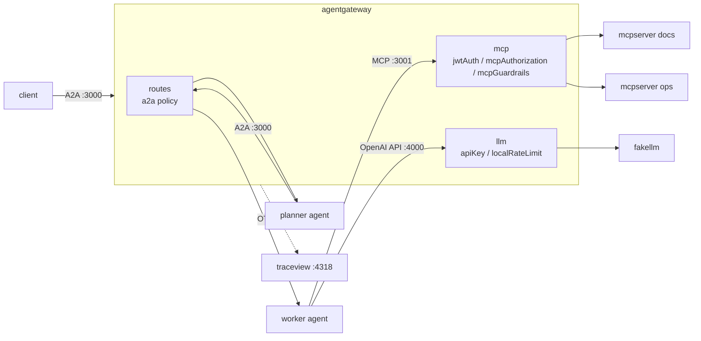

こんにちは。[ジェダイパンくず🍞](https://x.com/jedipunkz) です。

今年 (2026 年) は、「エージェントの通信をまとめて扱う gateway」が製品カテゴリとして立ち上がってきました。Kong は 4 月に AI Gateway 3.14 で Agent-to-Agent (A2A) のトラフィックに対応し、API7 は 8 月に A2A 1.0 を gateway でどう扱うかの記事を公開し、Maxim も 10 月に自社の Bifrost へ Agent Gateway を追加しています。そこで今回は OSS の [agentgateway](https://github.com/agentgateway/agentgateway) を使って、A2A・MCP・LLM の 3 種類のトラフィックを 1 つの gateway に通すサンプル環境を作り、手を動かしてみました。

動作確認のために書いたコードは下記に置いてあります。

https://github.com/jedipunkz/agent-gateway-playground

検証したバージョンは agentgateway v1.7.0、[a2a-go](https://github.com/a2aproject/a2a-go) v2.8.0 (A2A v1.0)、[MCP Go SDK](https://github.com/modelcontextprotocol/go-sdk) v1.8.0 です。環境は Linux で、Docker は使っていません。

## 用語集

この記事に出てくる用語のうち、まだ馴染みが薄そうなものをまとめておきます。

| 用語 | 説明 |
|---|---|
| A2A (Agent2Agent Protocol) | AI エージェント同士が通信するためのオープンなプロトコル。Google が提唱し、仕様と各言語の SDK が [a2aproject](https://github.com/a2aproject) で公開されています。この記事では v1.0 を使います |
| Agent Card | A2A のエージェントが「自分は何者で、どこにどう話しかければよいか」を書いて公開する JSON。`/.well-known/agent-card.json` に置かれ、名前・できること (skill)・呼び出し先の URL・必要な認証方式などが入ります。client は最初にこれを取得してからメッセージを送ります |
| context ID | A2A で 1 つの会話を表す ID。同じ会話の中の複数回のやりとりを束ねるのに使います |
| MCP (Model Context Protocol) | AI エージェントが外部の tool やデータにアクセスするためのプロトコル。tool を提供する側を MCP server と呼び、エージェントは `tools/list` で tool の一覧を取得し、`tools/call` で呼び出します |
| multiplex | agentgateway の機能で、複数の MCP server を 1 つの MCP server に見せるもの。束ねる MCP server ごとに target という名前を付け、束ねた後の tool 名は `<target 名>_<tool 名>` の形になります |
| JSON-RPC | JSON で「メソッド名と引数」を送り、結果を受け取る RPC の形式。MCP と A2A はどちらもこの形式でやりとりするので、HTTP のパスだけでは何を呼んだのかが分かりません |
| JWT の claim | JWT (署名付きのトークン) に入っている「誰か」「どの権限か」などの情報。この記事では `sub` (利用者) と、独自に追加した `role` (権限) を使います |
| CEL (Common Expression Language) | Google が作った小さな式言語。`jwt.role == "operator" && mcp.tool.name == "restart_service"` のような条件を 1 行で書いて評価します。ループや副作用が無く必ず短時間で終わるので、リクエストごとの判定に向いています。Kubernetes の ValidatingAdmissionPolicy でも使われています |
| guardrail | エージェントの入出力を検査して、危険なものを拒否したり書き換えたりする仕組み。agentgateway では MCP のリクエストやレスポンスに対して CEL の条件で設定できます |
| token (LLM) | LLM が文章を処理する単位。単語や文字のかけらに相当し、LLM API の課金や利用上限は token 数で決まります |
| bucket (rate limit) | rate limit で使用量を数える入れ物。「team ごとに 1 つ」のように分けておくと、ある team が上限に達しても別の team には影響しません |
| OTLP | OpenTelemetry の telemetry (trace・metrics・log) を送るためのプロトコル。この記事では HTTP 版 (OTLP/HTTP) を使います |
| traceparent | 分散 trace で、リクエストがどの trace のどの span から来たかを次のサービスに伝える HTTP ヘッダ。各サービスがこれを引き継ぐと、サービスをまたいだ処理が 1 本の trace になります |
| GenAI semantic conventions | OpenTelemetry が定めている、生成 AI 向けの telemetry の名前の付け方。たとえば入力 token 数は `gen_ai.usage.input_tokens` という名前で記録します。詳しくは [以前の記事](/post/otel-genai-agents/) にまとめました |

## Agent Gateway とは

AI エージェントが外とやりとりする通信は、大きく次の 3 種類に分けられます。

| 通信 | プロトコル | gateway が中身として見るもの |
|---|---|---|
| エージェント → LLM | OpenAI / Anthropic などの API | モデル名、入出力の token 数、プロンプト |
| エージェント → tool | MCP (JSON-RPC) | `tools/list` や `tools/call` などのメソッド、tool 名、引数 |
| エージェント → エージェント | A2A (JSON-RPC / REST / gRPC) | Agent Card、`SendMessage` などのメソッド、task の状態、context ID |

一般的な API gateway は主に HTTP のパスやヘッダを見て振り分けます。しかしこれらの通信はどれも中身を JSON-RPC や独自の JSON の本文で表すので、パスだけでは「どの tool を呼んだか」「どのエージェントのどの task か」が分かりません。Agent Gateway と呼ばれている製品は、これらのプロトコルを解釈して、その単位で認可・制限・観測をするものです。

参考にした各社の記事やドキュメントを読んで、A2A の扱いを比べると次のようになります。agentgateway 以外はドキュメントを読んだだけで、動かしてはいません。

| 製品 | A2A の扱い |
|---|---|
| [agentgateway](https://agentgateway.dev/docs/targets/a2a) | OSS (Apache-2.0、Rust)。route に `a2a` policy を付けると Agent Card の URL を書き換え、メソッドや task の状態をログに出す。A2A v0.3 と v1.0 の両方の形式を解釈する。MCP と LLM も同じバイナリで扱う |
| [Kong AI Gateway](https://developer.konghq.com/plugins/ai-a2a-proxy/) | 3.14 で AI A2A Proxy plugin が追加された。A2A のリクエストを検出して task のメタデータを抜き出し、Agent Card の URL を書き換える。認証は既存の認証 plugin を使う |
| [API7 AISIX](https://docs.api7.ai/ai-gateway/agent-gateway/overview) | エージェントごとに `/a2a/<agent>` の endpoint を作る。エージェントごとに A2A 1.0 か 0.3 を固定し、バージョン間の変換はしない。既定は拒否 |
| [Bifrost (Maxim)](https://www.getmaxim.ai/articles/a2a-protocol-gateway/) | 2026 年 10 月に Agent Gateway を追加。Agent Card をリクエストごとにエージェントから取り直し、endpoint と認証の情報を書き換えて返す |

どの製品も「Agent Card の URL を gateway に書き換えて、以降の呼び出しを gateway に向けさせる」という同じ発想で作られています。API7 の記事 [A2A Protocol 1.0 at the Gateway](https://api7.ai/blog/a2a-protocol-gateway-layer) では、A2A 1.0 で署名付き Agent Card やテナントのルーティングが仕様に入ったと書かれていました。一方で「どの署名者を信頼するか」「どの入力でテナントを決めるか」は運用者が決めることであり、その決定を強制する場所が gateway だ、というのがこの記事の主張です。

## サンプル環境の構成

エージェント、MCP server、LLM はすべて Go で書きました。LLM は OpenAI 互換の API で応答する fake LLM です。



planner は受け取ったメッセージを worker に転送するだけのエージェントで、worker は MCP の tool と LLM を呼んで返事を作ります。planner から worker への呼び出しも gateway を経由させています。

| パス | 内容 |
|---|---|
| `cmd/agent` | A2A v1.0 (JSON-RPC) エージェント。`-peer` で転送役、`-mcp` / `-llm` で tool と LLM を呼ぶ。`-send` で client として動く |
| `cmd/mcpserver` | Streamable HTTP の MCP server |
| `cmd/fakellm` | OpenAI 互換の `/v1/chat/completions` を返す fake LLM |
| `cmd/jwt` | シナリオ用の ES256 鍵と JWT を作る |
| `cmd/mcpcall` | MCP の `tools/list` と `tools/call` を行う client |
| `cmd/traceview` | OTLP/HTTP で受けた span をツリー表示する簡易 backend |
| `scenarios/` | シナリオごとの gateway 設定と実行スクリプト |

agentgateway は GitHub Releases のバイナリをそのまま使います。`scripts/setup.sh` がバイナリの取得と Go のビルドを行い、各シナリオは `run.sh` を実行するだけで再現できます。

```sh
./scripts/setup.sh
./scenarios/01-a2a/run.sh
```

### 設定ファイルの形式

agentgateway の設定ファイルには、listener と route を入れ子で書く `binds` 形式と、gateway・route・MCP・LLM をトップレベルに並べる `gateways` 形式があります。公式の example には `binds` 形式のものも多いのですが、`binds` には待ち受けアドレスを指定する項目が無く、全インターフェースで listen します。今回は `gateways.*.bindAddress` で `127.0.0.1` を指定できる `gateways` 形式に統一しました。readiness (`:15021`) と metrics (`:15020`) も既定では全インターフェースで listen するので、`config` で loopback に限定しています。

```yaml
config:
  # 未指定だと agentgateway が鍵を生成してこのファイルに書き込むため、環境変数で渡す
  session:
    key: $SESSION_KEY
  readinessAddr: 127.0.0.1:15021
  statsAddr: 127.0.0.1:15020
gateways:
  a2a:
    port: 3000
    bindAddress: 127.0.0.1
```

`config.session.key` はセッション ID の暗号化に使う鍵で、未指定のまま起動すると agentgateway が鍵を生成して設定ファイルに追記します。気付かずに commit すると鍵がリポジトリに入るので注意が必要です。値に `$SESSION_KEY` と書けば環境変数から読まれます。環境変数が無い場合は起動時にエラーになります。

## シナリオ 01: A2A エージェントを gateway の配下に並べる

planner と worker の 2 体を、1 つの gateway の配下に `/planner` と `/worker` のパスで並べます。route に `a2a: {}` を付けると、その route は A2A のトラフィックとして扱われます。

```yaml
routes:
- name: planner
  gateways: a2a
  matches:
  - path:
      pathPrefix: /planner
  policies:
    urlRewrite:
      path:
        prefix: /
    a2a: {}
  backends:
  - host: 127.0.0.1:9302
- name: worker
  gateways: a2a
  matches:
  - path:
      pathPrefix: /worker
  policies:
    urlRewrite:
      path:
        prefix: /
    a2a: {}
  backends:
  - host: 127.0.0.1:9301
```

エージェントの実装は a2a-go の JSON-RPC handler に、受け取ったテキストを処理する関数を渡すだけです。Agent Card には自分自身の URL (`http://127.0.0.1:9302/invoke`) を書いています。

(Agent Card とは A2A エージェントが「自分は何者でどこにどう話しかければよいか」を書いて公開する jSON です)

```go
card := &a2a.AgentCard{
	Name:        *name,
	Description: *name + " agent",
	// gateway はこの URL を自分の URL に書き換えて返す (agent card rewrite)
	SupportedInterfaces: []*a2a.AgentInterface{
		a2a.NewAgentInterface("http://"+*addr+"/invoke", a2a.TransportProtocolJSONRPC),
	},
	// ...
}

mux := http.NewServeMux()
mux.Handle("/invoke", a2asrv.NewJSONRPCHandler(a2asrv.NewHandler(exec)))
mux.Handle(a2asrv.WellKnownAgentCardPath, a2asrv.NewStaticAgentCardHandler(card))
```

### Agent Card の書き換え

backend から直接取った Agent Card と、gateway 経由で取った Agent Card を比べます。

```sh
$ curl -s http://127.0.0.1:9302/.well-known/agent-card.json | jq '.supportedInterfaces'
[
  {
    "url": "http://127.0.0.1:9302/invoke",
    "protocolBinding": "JSONRPC",
    "protocolVersion": "1.0"
  }
]

$ curl -s http://127.0.0.1:3000/planner/.well-known/agent-card.json | jq '.supportedInterfaces'
[
  {
    "url": "http://127.0.0.1:3000/planner/invoke",
    "protocolBinding": "JSONRPC",
    "protocolVersion": "1.0"
  }
]
```

gateway 経由では `url` が `http://127.0.0.1:3000/planner/invoke` に書き換わっています。A2A の client は Agent Card に書かれた URL にメッセージを送るので、最初に gateway から Agent Card を取りさえすれば、以降の呼び出しも gateway を通ります。agentgateway は A2A v1.0 の `supportedInterfaces[].url` と v0.3 の `url` の両方に対応していて、`urlRewrite` でパスを書き換えている場合も、それを考慮した URL に直してくれます。

### メッセージを送る

client から planner にメッセージを送ると、planner が gateway 経由で worker に転送し、worker の返事が返ってきます。

```sh
$ bin/agent -name client -send http://127.0.0.1:3000/planner "checkout"
[planner] [worker] received "checkout"
```

gateway のアクセスログです (一部抜粋しています)。

```plain
route=default/planner http.method=GET http.path=/planner/.well-known/agent-card.json http.status=200 protocol=a2a duration=0ms
route=default/worker http.method=GET http.path=/worker/.well-known/agent-card.json http.status=200 protocol=a2a duration=0ms
route=default/worker http.method=POST http.path=/worker/invoke http.status=200 protocol=a2a a2a.method=SendMessage a2a.response.outcome=success a2a.result.kind=message a2a.context.id=01a1d56f-d37b-7d59-a75a-092092397b75 duration=0ms
route=default/planner http.method=POST http.path=/planner/invoke http.status=200 protocol=a2a a2a.method=SendMessage a2a.response.outcome=success a2a.result.kind=message a2a.context.id=01a1d56f-d37a-7a99-b1f4-4f1d5f1237de duration=1ms
```

`a2a.method=SendMessage` が A2A v1.0 のメソッド名です (v0.3 では `message/send`)。応答の種類 (`message` か `task`)、task の状態、エラーコード、context ID もログに出ます。

ただし context ID は planner と worker で別の値になっています。A2A の context ID は会話の単位で、planner が worker に新しいメッセージを送ると、worker 側では別の会話として扱われるためです。エージェントをまたいで 1 つのリクエストを追うには、後述のシナリオ 04 の trace を使います。

### a2a-go で path 付きの URL を扱う

gateway の配下にパスで並べたエージェントを a2a-go の client から呼ぶとき、一点つまずきました。`agentcard.Resolver.Resolve()` に `http://127.0.0.1:3000/planner` を渡すと 404 になります。a2a-go は base URL のパスが空か `/` のときだけ `/.well-known/agent-card.json` を付け、パスがあればその URL を Agent Card の URL そのものとみなすためです。`WithPath` で明示すれば解決します。

```go
card, err := agentcard.NewResolver(hc).Resolve(ctx, cardURL, agentcard.WithPath(a2asrv.WellKnownAgentCardPath))
```

## シナリオ 02: MCP server を束ねて tool 単位で認可する

docs と ops という 2 つの MCP server を、1 つの endpoint (`:3001/mcp`) に束ねてみます。agentgateway は複数の MCP server を 1 つの MCP server に見せる multiplex の機能を持っていて、束ねた後の tool 名は `<target 名>_<tool 名>` の形になります。

認可には JWT の claim を使います。JWT は `cmd/jwt` で作り、`role` claim に `viewer` か `operator` を入れています。読み取り系の tool (`search_docs`、`get_status`) は誰でも使え、`restart_service` は operator だけが使える、というルールです。

```yaml
mcp:
  gateways: mcp
  policies:
    jwtAuth:
      mode: strict
      providers:
      - issuer: agent-gateway-playground
        audiences: [playground]
        jwks:
          file: ./jwt/jwks.json
    # tool 単位の認可。判定に使えるのは tool 名・target・JWT claim など (引数は見えない)
    mcpAuthorization:
      rules:
      # 有効な JWT があれば読み取り系 tool は使える
      - allow: 'mcp.tool.name in ["search_docs", "get_status"]'
      # restart_service は operator だけ
      - allow: 'jwt.role == "operator" && mcp.tool.name == "restart_service"'
  targets:
  - name: docs
    mcp:
      host: http://127.0.0.1:9201/mcp
  - name: ops
    mcp:
      host: http://127.0.0.1:9202/mcp
```

`run.sh` の出力です。

```plain
## token なし
connect: calling "initialize": sending "initialize": Unauthorized

## viewer: tools/list と restart_service
tool: docs_search_docs
tool: ops_get_status
call: calling "tools/call": sending "tools/call": unknown resource: rejected by transport: Bad Request

## operator: restart_service (checkout)
tool: docs_search_docs
tool: ops_get_status
tool: ops_restart_service
result (isError=false): checkout: restarted
```

viewer の `tools/list` には `ops_restart_service` が出てきません。許可されない tool は一覧から消えるので、エージェントはそもそも呼べる tool として認識しません。それでも名前を指定して呼ぶと 400 で拒否されます。ログには誰が (`jwt.sub`) どの target のどの tool を呼んで、なぜ拒否されたのかが残ります。

```plain
http.status=401 protocol=http error="authentication failure: no bearer token found" reason=JwtAuth
http.status=400 jwt.sub=alice protocol=mcp mcp.method.name=tools/call mcp.target=ops mcp.resource.type=tool gen_ai.tool.name=restart_service error="mcp: authorization denied for tool: ops_restart_service" reason=Authorization
http.status=200 jwt.sub=bob protocol=mcp mcp.method.name=tools/call mcp.target=ops mcp.resource.type=tool gen_ai.tool.name=restart_service
```


### mcpGuardrails

引数を見るには `mcpGuardrails` を使います。guardrail は MCP のリクエストやレスポンスを CEL 式で検査し、拒否 (`reject`) や書き換え (`transform`) ができる機能です。

```yaml
    # 引数を見た制御は guardrail で行う。payments の再起動は operator でも拒否する
    mcpGuardrails:
      processors:
      - kind: expression
        methods: {"tools/call": request}
        condition: >-
          mcp.tool.target == "ops" &&
          mcp.params.name == "restart_service" &&
          has(mcp.params.arguments.service) &&
          mcp.params.arguments.service == "payments"
        reject: "restarting payments requires a change request"
```

```plain
## operator: restart_service (payments) -> guardrail
result (isError=true): restarting payments requires a change request
```

```plain
http.status=200 jwt.sub=bob protocol=mcp mcp.method.name=tools/call mcp.target=ops mcp.resource.type=tool gen_ai.tool.name=restart_service error="mcp: mcpGuardrails rejected: restarting payments requires a change request" reason=MCP
```

認可で拒否された場合は HTTP 400 になり、client 側では `tools/call` の呼び出し自体が失敗しました。一方、guardrail で拒否された場合は HTTP 200 で、tool の結果として `isError: true` とメッセージが返ります。エージェントから見ると「tool を呼んだら失敗した」という扱いになるので、LLM は理由を読んで別の手を考えられます。


## シナリオ 03: LLM に API key 認証と token rate limit をかける

fake LLM を OpenAI 互換の custom provider として登録し、team ごとに API key を発行して、team ごとの token 上限 (1 分あたり 40 token) を設定します。

```yaml
llm:
  gateways: llm
  policies:
    apiKey:
      mode: strict
      location:
        header:
          name: authorization
          prefix: 'Bearer '
      keys:
      - key: $TEAM_A_KEY
        metadata:
          team: team-a
      - key: $TEAM_B_KEY
        metadata:
          team: team-b
    # team ごとに 1 分あたり 40 token まで
    localRateLimit:
    - type: tokens
      maxTokens: 40
      tokensPerFill: 40
      fillInterval: 60s
      key: apiKey.team
  models:
  - name: fake
    provider:
      custom:
        formats:
        - type: completions
    params:
      baseUrl: http://127.0.0.1:9100/v1
      model: fake-1
```

key に付けた `metadata` は CEL から `apiKey.team` として参照できるので、rate limit の bucket を team 単位にしています。client は `model: fake` を指定し、gateway が `fake-1` に置き換えて fake LLM に送ります。

```plain
## key なし
401 authentication failed

## team-a を 5 回 (上限 40 token/分)
200 {"prompt_tokens":5,"completion_tokens":7,"total_tokens":12}
200 {"prompt_tokens":5,"completion_tokens":7,"total_tokens":12}
200 {"prompt_tokens":5,"completion_tokens":7,"total_tokens":12}
200 {"prompt_tokens":5,"completion_tokens":7,"total_tokens":12}
429 rate limit exceeded

## team-b (別 bucket)
200 {"prompt_tokens":5,"completion_tokens":7,"total_tokens":12}
```

1 回 12 token なので、上限が 40 token なら 3 回で止まりそうですが、実際には 4 回目まで通って 5 回目で 429 になりました。token 数はレスポンスを受け取るまで分からないので、リクエストの時点では残りがあるかだけを見て通し、レスポンスの token 数を後から差し引いているようです (ソースまでは確認していません)。上限は「1 リクエスト分はみ出しうる目安」として設定する必要があります。

アクセスログと metrics には、OTel GenAI semantic conventions の名前で token 数が出ます。[前回の記事](/post/otel-genai-agents/) ではエージェントごとに token 数の属性名がばらばらでしたが、LLM の呼び出しを gateway に通せば、どのエージェントから呼んでも同じ名前で集計できます。

```plain
http.status=200 protocol=llm gen_ai.operation.name=chat gen_ai.provider.name=custom gen_ai.request.model=fake-1 gen_ai.response.model=fake-1 agw.ai.original_model=fake gen_ai.usage.input_tokens=5 gen_ai.usage.output_tokens=7
http.status=429 protocol=llm agw.ai.original_model=fake error="rate limit exceeded" reason=RateLimit
```

```plain
agentgateway_gen_ai_client_token_usage_sum{gen_ai_token_type="input",gen_ai_operation_name="chat",gen_ai_system="custom",gen_ai_request_model="fake-1",gen_ai_response_model="fake-1"} 25.0
agentgateway_gen_ai_client_token_usage_sum{gen_ai_token_type="output",gen_ai_operation_name="chat",gen_ai_system="custom",gen_ai_request_model="fake-1",gen_ai_response_model="fake-1"} 35.0
```

## シナリオ 04: エージェントをまたいだ trace

最後に、01〜03 の設定を 1 つの gateway プロセスにまとめ、client → planner → worker → MCP / LLM の流れを 1 本の trace で見ます。gateway の設定には trace の送り先を足すだけです。

```yaml
config:
  tracing:
    otlpEndpoint: http://127.0.0.1:4318
    otlpProtocol: http
    randomSampling: "true"
```

エージェント側は、受けるリクエストを `otelhttp.NewHandler` で包み、送るリクエストは `otelhttp.NewTransport` を通して、`traceparent` ヘッダを伝搬させます。A2A の client にも MCP の client にも `*http.Client` を渡せるので、エージェントのコードに trace の処理はほとんど入りません。

```go
func Client(header, value string) *http.Client {
	var rt http.RoundTripper = otelhttp.NewTransport(http.DefaultTransport)
	if value != "" {
		rt = headerRT{rt, header, value}
	}
	return &http.Client{Transport: rt}
}
```

trace の backend には、OTLP/HTTP で受けた span をツリー表示するだけの `cmd/traceview` を書いて使いました。実行結果です。

```plain
trace 060470cb44a14a16e8ec4c68974468c4 (39 spans)
  - [client] send http://127.0.0.1:3000/planner
    - [client] HTTP GET
      - [agentgateway] GET /planner/*
        - [agentgateway] GET
          - [planner] GET /.well-known/agent-card.json
    - [client] HTTP POST
      - [agentgateway] POST /planner/* a2a.method=SendMessage
        - [agentgateway] POST
          - [planner] POST /invoke
            - [planner] HTTP GET
              - [agentgateway] GET /worker/*
                - [agentgateway] GET
                  - [worker] GET /.well-known/agent-card.json
            - [planner] HTTP POST
              - [agentgateway] POST /worker/* a2a.method=SendMessage
                - [agentgateway] POST
                  - [worker] POST /invoke
                    - [worker] HTTP POST
                      - [agentgateway] server/discover
                        - [agentgateway] server/discover docs
                        - [agentgateway] server/discover ops
                    - [worker] HTTP POST
                      - [agentgateway] initialize
                        - [agentgateway] initialize docs
                        - [agentgateway] initialize ops
                    - [worker] HTTP POST
                      - [agentgateway] notifications/initialized
                        - [agentgateway] notifications/initialized docs
                        - [agentgateway] notifications/initialized ops
                    - [worker] HTTP POST
                      - [agentgateway] tools/call gen_ai.tool.name=get_status
                        - [agentgateway] tools/call ops_get_status gen_ai.tool.name=get_status
                    - [worker] HTTP DELETE
                      - [agentgateway] DELETE /mcp/*
                        - [agentgateway] DELETE docs
                        - [agentgateway] DELETE ops
                    - [worker] HTTP POST
                      - [agentgateway] POST /v1/chat/completions gen_ai.operation.name=chat gen_ai.usage.input_tokens=8 gen_ai.usage.output_tokens=10
                        - [agentgateway] POST
```

client から LLM の呼び出しまでが 1 本の trace につながりました。gateway は受けた `traceparent` を引き継いで自分の span を作り、backend に転送するときにも `traceparent` を付けています。A2A の span には `a2a.method`、MCP の span には `gen_ai.tool.name`、LLM の span には token 数が付くので、trace を見るだけで「planner がどのエージェントを呼び、そのエージェントがどの tool を呼び、LLM に何 token 使ったか」が分かります。シナリオ 01 で見たとおり context ID はエージェントごとに別になるので、エージェントをまたいだ追跡は trace ID で行うことになります。

trace からは multiplex のコストも見えます。worker は `ops_get_status` を 1 回呼んだだけですが、`server/discover`、`initialize`、`notifications/initialized`、セッション終了の `DELETE` は docs と ops の両方に送られています。束ねる MCP server が増えると、セッションを張るたびに送られるリクエストも、その数に比例して増えます。

## 気になった点

- 設定ファイルに `config.session.key` が無いと、agentgateway が起動時に鍵を生成して設定ファイルに書き込みます。
- `binds` 形式の設定では待ち受けアドレスを指定できず、全インターフェースで listen します。readiness と metrics の port も既定では全インターフェースです。
- CEL のリファレンスに載っている変数でも、使える場所が限られているものがあります (`mcp.tool.arguments` は認可では使えず、`mcp.target.name` は guardrail で評価エラーになる)。ルールを書いたら、許可されるケースと拒否されるケースの両方を実際に呼んで確かめる必要があると思いました。
- gateway は経路上の判定点なので、エージェントが gateway を迂回して backend を直接呼べると意味がありません。今回は全部 `127.0.0.1` で動かしているので、planner から worker の port を直接叩くこともできます。本番では、backend にはネットワーク上 gateway からしか届かないようにするか、[OpenShell](/post/openshell/) のようなサンドボックスで外向きの通信を gateway だけに絞る必要があります。

## まとめ

agentgateway を使って、A2A・MCP・LLM の 3 種類のトラフィックを 1 つの gateway に通してみました。Agent Card の書き換えでエージェント間の呼び出しを gateway に寄せられること、MCP の tool を JWT の claim で絞ると一覧からも消えること、LLM の token を team 単位で制限できること、そしてそれらがすべて同じ形式のログと 1 本の trace に残ることを確認できました。エージェントが増えても「誰が何を呼んだか」を 1 か所で答えられるのは、運用する側として安心材料になると感じました。

一方で、認可ルールでは tool の引数を参照できず guardrail で補う必要があることや、CEL の変数が使える場所の違いなど、まだ発展途上の部分もありました。
