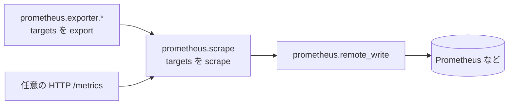
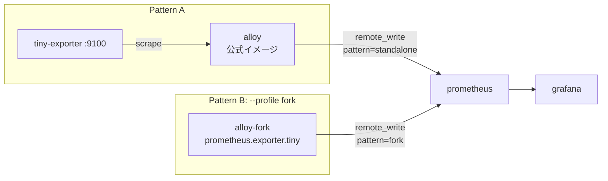

こんにちは。[ジェダイパンくず🍞](https://x.com/jedipunkz) です。

以前の記事 [自前開発した Prometheus Exporter で自宅ルータのメトリクス監視運用している話](/post/linux-tiny-exporter/) や [Prometheus Exporter 開発で Discord サーバ運営の健全化を図る](/post/discord-exporter/) では、Go で Prometheus Exporter を書いて Prometheus Server に scrape させていました。

最近は Grafana のエージェントとして [Grafana Alloy](https://github.com/grafana/alloy) を使う構成が増えています。Alloy は Prometheus の scrape や remote_write、OpenTelemetry、ログ収集などを 1 つのバイナリで扱えるテレメトリコレクタで、`prometheus.exporter.*` という形で多くの exporter を内蔵しています。そこで「自作 exporter を Alloy の世界に持ち込むにはどうするのか」「Alloy の component そのものを Go で書けるのか」を調べて、実際に手を動かしてみました。

コードは下記に置いてあります。

https://github.com/jedipunkz/alloy-playground

## 結論

自作のメトリクスを Alloy で扱う方法は大きく 2 つあります。

| パターン | 内容 |
|---|---|
| A: 独立 exporter + `prometheus.scrape` | 従来通り Go で exporter を書き、公式の Alloy から HTTP で scrape する |
| B: Alloy を fork して component を追加 | Alloy のソースツリーに `internal/component/prometheus/exporter/<name>` を足してビルドする |

Alloy の component は Go で書けます。ただし Alloy にはプラグイン機構が無く、exporter 系 component が使う API は `internal/` 配下にあるため、パターン B は Alloy を fork してビルドするしかありません。自分のサービス向けの独自メトリクスであれば、運用コストの低いパターン A を選ぶのが良さそうだと感じました。

## Alloy のパイプラインのおさらい

Alloy は component をつないでパイプラインを組みます。メトリクスの場合は典型的に次の流れになります。



`prometheus.exporter.*` component は自分でメトリクスを送るのではなく、「自分を scrape するための target」を export します。それを `prometheus.scrape` が受け取って scrape し、`prometheus.remote_write` で送信します。`prometheus.scrape` には任意の HTTP endpoint も渡せるので、従来の exporter もそのまま scrape できます。この 2 つの入口がそれぞれパターン A と B に対応します。

なお Alloy には `declare` ブロックで独自 component を定義する仕組みもありますが、これは既存の component を Alloy の設定言語で組み合わせるもので、Go のコードを足せるわけではありません。

## サンプルの構成

両パターンとも、`/proc/loadavg` を読んで `tiny_load_average{period="1m|5m|15m"}` を出すだけの同じ collector を使います。docker compose で Prometheus / Alloy / Grafana を起動し、Alloy から Prometheus へ remote_write します。どちらのパターンから来たデータかは `external_labels` の `pattern` ラベルで区別します。



| フォルダ | 内容 |
|---|---|
| `standalone-exporter/` | パターン A の Go 製 exporter |
| `alloy-fork/` | パターン B の component と、Alloy をソースからビルドする Dockerfile |
| `config/` | Alloy の設定ファイルと Grafana の datasource |
| `compose.yaml` | Prometheus / Grafana / Alloy / exporter |

### 共通の collector

`prometheus.Collector` interface を実装した collector です。scrape されるたびに `/proc/loadavg` を読み、先頭 3 つの値を gauge として返します。

```go
type loadCollector struct {
	path string
	desc *prometheus.Desc
}

func newLoadCollector(path string) *loadCollector {
	return &loadCollector{
		path: path,
		desc: prometheus.NewDesc("tiny_load_average", "System load average.", []string{"period"}, nil),
	}
}

func (c *loadCollector) Describe(ch chan<- *prometheus.Desc) { ch <- c.desc }

func (c *loadCollector) Collect(ch chan<- prometheus.Metric) {
	b, err := os.ReadFile(c.path)
	if err != nil {
		ch <- prometheus.NewInvalidMetric(c.desc, err)
		return
	}
	loads, err := parseLoadavg(string(b))
	if err != nil {
		ch <- prometheus.NewInvalidMetric(c.desc, err)
		return
	}
	for i, period := range []string{"1m", "5m", "15m"} {
		ch <- prometheus.MustNewConstMetric(c.desc, prometheus.GaugeValue, loads[i], period)
	}
}
```

この collector 自体は Alloy に依存しません。ここがポイントで、パターン A と B の違いは「この collector を誰がホストするか」だけです。

## パターン A: 独立 exporter + prometheus.scrape

### exporter

collector を registry に登録して `/metrics` で公開するだけの、いつもの exporter です。デフォルトの listen address は `127.0.0.1:9100` にしていて、compose では `-listen-address=:9100` を渡してコンテナネットワーク内にだけ公開しています。

```go
func main() {
	addr := flag.String("listen-address", "127.0.0.1:9100", "address to expose /metrics on")
	loadavg := flag.String("loadavg-path", "/proc/loadavg", "path to loadavg file")
	flag.Parse()

	reg := prometheus.NewRegistry()
	reg.MustRegister(newLoadCollector(*loadavg))

	mux := http.NewServeMux()
	mux.Handle("/metrics", promhttp.HandlerFor(reg, promhttp.HandlerOpts{}))
	srv := &http.Server{
		Addr:              *addr,
		Handler:           mux,
		ReadHeaderTimeout: 5 * time.Second,
		ReadTimeout:       10 * time.Second,
		WriteTimeout:      10 * time.Second,
	}
	log.Printf("listening on %s", *addr)
	log.Fatal(srv.ListenAndServe())
}
```

手元で起動して curl すると次のように返ります。

```text
# HELP tiny_load_average System load average.
# TYPE tiny_load_average gauge
tiny_load_average{period="15m"} 0.08
tiny_load_average{period="1m"} 0.22
tiny_load_average{period="5m"} 0.15
```

### Alloy の設定

公式の `grafana/alloy` イメージに、exporter を scrape して remote_write する設定を渡すだけです。

```alloy
prometheus.scrape "tiny" {
  targets         = [{"__address__" = "tiny-exporter:9100"}]
  scrape_interval = "15s"
  forward_to      = [prometheus.remote_write.local.receiver]
}

prometheus.remote_write "local" {
  external_labels = {pattern = "standalone"}

  endpoint {
    url = "http://prometheus:9090/api/v1/write"
  }
}
```

Prometheus 側は `--web.enable-remote-write-receiver` を付けて起動し、remote_write を受け付けるようにしています。

## パターン B: Alloy を fork して component を追加

### component の登録

Alloy 本体の `prometheus.exporter.dnsmasq` などを読むと、exporter 系 component は次の 3 つで構成されています。

- `component.Register`: `init()` で component 名・引数の型・build 関数を登録する
- `exporter.New`: integration を component に変換し、自分を scrape するための `targets` を export する
- `integrations.NewCollectorIntegration`: `prometheus.Collector` を integration として包む

これに倣って `prometheus.exporter.tiny` を書くと次のようになります。

```go
func init() {
	component.Register(component.Registration{
		Name:      "prometheus.exporter.tiny",
		Stability: featuregate.StabilityExperimental,
		Args:      Arguments{},
		Exports:   exporter.Exports{},

		Build: exporter.New(createExporter, "tiny"),
	})
}

// Arguments configures the prometheus.exporter.tiny component.
type Arguments struct {
	LoadavgPath string `alloy:"loadavg_path,attr,optional"`
}

// DefaultArguments holds the default arguments for prometheus.exporter.tiny.
var DefaultArguments = Arguments{LoadavgPath: "/proc/loadavg"}

// SetToDefault implements syntax.Defaulter.
func (a *Arguments) SetToDefault() { *a = DefaultArguments }

func createExporter(opts component.Options, args component.Arguments) (integrations.Integration, string, error) {
	a := args.(Arguments)
	i := integrations.NewCollectorIntegration("tiny",
		integrations.WithLogger(opts.Logger),
		integrations.WithCollectors(newLoadCollector(a.LoadavgPath)),
	)
	// loadavg is host-level, so use the hostname as the instance label.
	return i, common.HostNameInstanceKey(), nil
}
```

要点は次の通りです。

- `Arguments` の struct tag `alloy:"loadavg_path,attr,optional"` が、Alloy 設定ファイルで書ける属性になる
- `SetToDefault` で属性を省略したときのデフォルト値を決める
- `createExporter` の 2 つ目の戻り値が `instance` ラベルになる。loadavg はホスト単位の値なのでホスト名を使った
- `job` ラベルは `exporter.New` によって `integrations/tiny` になる
- `Stability` を `StabilityExperimental` にしたので、起動時に `--stability.level=experimental` が必要になる

`Arguments` が Alloy の設定言語として正しく読めるかは、Alloy の `syntax.Unmarshal` を使ってテストできます。

```go
func TestUnmarshalAlloy(t *testing.T) {
	var args Arguments
	if err := syntax.Unmarshal([]byte(``), &args); err != nil {
		t.Fatal(err)
	}
	if args != DefaultArguments {
		t.Fatalf("got %+v, want defaults", args)
	}

	if err := syntax.Unmarshal([]byte(`loadavg_path = "/host/proc/loadavg"`), &args); err != nil {
		t.Fatal(err)
	}
	if args.LoadavgPath != "/host/proc/loadavg" {
		t.Fatalf("got %q", args.LoadavgPath)
	}
}
```

component を有効にするには、Alloy の `internal/component/all` パッケージから blank import されている必要があります。本体の `all.go` を編集すると upstream 追従時に conflict しやすいので、別ファイルとして足しています。

```go
package all

// Copied into the Alloy source tree as internal/component/all/tiny.go.
import (
	_ "github.com/grafana/alloy/internal/component/prometheus/exporter/tiny" // Import prometheus.exporter.tiny
)
```

### なぜ fork が必要か

上のコードは `github.com/grafana/alloy/internal/...` を import しています。Go の仕様で `internal/` 配下のパッケージは、その親ディレクトリ以下からしか import できません。つまり別モジュールから `prometheus.exporter.tiny` だけを提供することはできず、Alloy のソースツリーにファイルを置いてビルドする必要があります。

### ビルド

Alloy v1.21.1 の `make alloy` を読むと、実体は `collector/` ディレクトリ（OpenTelemetry Collector Builder で生成された main パッケージ）での `go build` でした。Dockerfile では upstream を clone し、ファイルをコピーして同じ場所でビルドしています。UI のビルドは省いているので、このバイナリの Web UI は使えず API のみになります。

```dockerfile
FROM golang:1.27.3 AS build
ARG ALLOY_VERSION=v1.21.1
RUN git clone --depth 1 --branch ${ALLOY_VERSION} https://github.com/grafana/alloy.git /src/alloy
WORKDIR /src/alloy
COPY tiny internal/component/prometheus/exporter/tiny
COPY all_tiny.go internal/component/all/tiny.go
RUN --mount=type=cache,target=/root/.cache/go-build \
    --mount=type=cache,target=/go/pkg/mod \
    cd collector && CGO_ENABLED=0 go build -tags "netgo gore2regex" -o /out/alloy .

FROM gcr.io/distroless/static-debian12:nonroot
COPY --from=build /out/alloy /bin/alloy
ENTRYPOINT ["/bin/alloy"]
```

### Alloy の設定

自作 component を通常の component と同じように書けます。`prometheus.exporter.tiny.host.targets` を `prometheus.scrape` に渡すのは、本体の exporter component と同じ使い方です。

```alloy
prometheus.exporter.tiny "host" {
  loadavg_path = "/proc/loadavg"
}

prometheus.scrape "tiny" {
  targets         = prometheus.exporter.tiny.host.targets
  scrape_interval = "15s"
  forward_to      = [prometheus.remote_write.local.receiver]
}

prometheus.remote_write "local" {
  external_labels = {pattern = "fork"}

  endpoint {
    url = "http://prometheus:9090/api/v1/write"
  }
}
```

ビルドしたバイナリをこの設定で起動し、Alloy の HTTP server から component 単体のメトリクスを取ると次のようになりました（ビルド直後でロードアベレージが高くなっています）。

```sh
./alloy run --server.http.listen-addr=127.0.0.1:12345 --stability.level=experimental config/alloy/fork.alloy
curl -s http://127.0.0.1:12345/api/v0/component/prometheus.exporter.tiny.host/metrics
```

```text
tiny_build_info{branch="",goarch="amd64",goos="linux",goversion="go1.27.3",revision="bd570c68ab36fd1328a7d50e79a4e70932a84c54-modified",tags="netgo,gore2regex",version="v1.21.1-devel"} 1
tiny_load_average{period="15m"} 8.7
tiny_load_average{period="1m"} 25.21
tiny_load_average{period="5m"} 20.46
```

`tiny_build_info` は自分では書いていません。`NewCollectorIntegration` の metrics handler が `<integration 名>_build_info` を自動で登録するためです。exporter のプロセスやポートを別に用意しなくても、Alloy の HTTP server 経由でメトリクスが出ていることが分かります。

## docker compose で動かす

パターン A だけを起動する場合は次の通りです。

```sh
docker compose up -d --build
```

パターン B は Alloy 全体をソースからビルドするので、compose の profile で分けています。

```sh
docker compose --profile fork up -d --build
```

| URL | 内容 |
|---|---|
| http://127.0.0.1:3000 | Grafana。Explore で `tiny_load_average` を検索する |
| http://127.0.0.1:9090 | Prometheus |
| http://127.0.0.1:12345 | Alloy (パターン A) の UI |
| http://127.0.0.1:12346 | Alloy (パターン B)。UI 無し、API のみ |

ポートはすべて `127.0.0.1` に bind しています。

## 比較

| | パターン A: 独立 exporter + `prometheus.scrape` | パターン B: Alloy を fork して component 追加 |
|---|---|---|
| Alloy 本体 | 公式イメージをそのまま使える。upgrade はタグを上げるだけ | 自前ビルド。upgrade ごとに upstream へ追従して再ビルドが必要 |
| 依存する API | `client_golang` の公開 API のみ | Alloy の `internal/` API。リリース間の互換性の保証が無い |
| ビルド (実測) | 依存 module 33 個、バイナリ 14MB | Alloy 全体のビルドが必要。依存 module 2043 個、バイナリ 536MB |
| プロセス / ネットワーク | exporter のプロセスとポートが増える。exporter 側の公開範囲を管理する必要がある | 単一バイナリ。追加ポート不要 (Alloy の HTTP server 経由) |
| 設定 | exporter の flag / env と Alloy の設定が分かれる | Alloy 設定の属性で渡せ、他 component の出力を式で参照できる |
| 再利用性 | Prometheus 単体や他のエージェントからも scrape できる | Alloy 専用 |
| 可観測性 | exporter の状態は `up` メトリクスで見る | Alloy の UI / health に component として出る |
| 脆弱性対応 | Grafana の公式リリースに任せられる | 自分で再ビルドして配布する |

ビルドの差は想像以上でした。パターン B は 1 つの component を足すだけでも Alloy 全体（AWS / Azure / Datadog などの SDK を含む 2000 以上の module）をビルドすることになり、初回は依存のダウンロードだけでかなり時間がかかります。

判断の目安としては次のように考えています。

- 自分のサービス向けの独自メトリクスならパターン A。exporter は Alloy 以外からも使え、Alloy の upgrade にも縛られない
- 既存の OSS exporter を Alloy に統合したい、あるいは upstream に contribute したいならパターン B。Alloy 本体の `prometheus.exporter.*` も、既存 exporter の collector パッケージをこの形で包んでいる（例: `internal/static/integrations/dnsmasq_exporter` は `github.com/google/dnsmasq_exporter/collector` を包んでいる）

## まとめ

Alloy の component は Go で書け、`component.Register` / `exporter.New` / `NewCollectorIntegration` の 3 つを押さえれば、既存の `prometheus.Collector` を数十行で component にできました。一方で `internal/` に依存するため fork とフルビルドが前提になり、個人やチームで運用するにはコストが大きいです。自作 exporter を Alloy で扱うだけであれば、これまで通り exporter を書いて `prometheus.scrape` で scrape するのが一番シンプルだと感じました。
