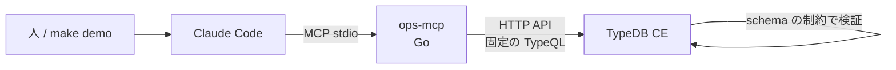

こんにちは。[ジェダイパンくず🍞](https://x.com/jedipunkz) です。

Netflix TechBlog の [Ontology-Driven Observability](https://netflixtechblog.com/ontology-driven-observability-building-an-end-to-end-knowledge-graph-at-netflix-scale-421392cf5adf) を読みました。運用データを ontology という共通の語彙で定義した知識グラフにまとめ、根因分析をするエージェントがそのグラフを検索する、という内容です。グラフを保存する QuipuDB は Netflix 社内の実装で、公開されていません。

そこで同じ考え方を手元で小さく試しました。運用情報は [TypeDB](https://typedb.com/) に入れ、ontology は TypeDB の schema として定義しています。エージェントには Claude Code を使い、Go で書いた MCP server を経由して DB を読み書きさせました。

動作確認のために書いたコードは下記に置いてあります。

https://github.com/jedipunkz/ops-ontology-playground

検証したバージョンは TypeDB CE 3.14.2、[MCP Go SDK](https://github.com/modelcontextprotocol/go-sdk) v1.8.0、Claude Code 2.1.325、Go 1.27.4 です。環境は WSL2 の Ubuntu 26.04 です。TypeDB は Docker 29.1.3 と Compose 2.40.3 で動かしました。

## 作ったもの

エージェントは次の 3 つのことをします。

1. DB から schema を読み、どんな型と関係があるかを知る
2. インシデントとデプロイを検索し、根因の仮説を立てる
3. 仮説を DB に書き込む。schema に反する書き込みは DB が拒否する

書き込んだ仮説は、次に調査するエージェントが読めます。2 回目のエージェントは前回の仮説を見つけ、同じ仮説を重複して書きませんでした。

| Netflix の記事 | この playground |
|---|---|
| Observability の ontology | `ontology/schema.tql` に書いた TypeDB の schema |
| QuipuDB | TypeDB CE |
| 運用システムからのデータ収集 | 手書きの synthetic data |
| 根因分析のエージェント | Claude Code と MCP server |

Netflix の本番システムは再現していません。確かめたのは、エージェントが運用知識をどう読み、どういう制約を通して書くかです。

## なぜ TypeDB か

最初は Apache Jena Fuseki で作りました。RDF/OWL で ontology を書き、エージェントの仮説を一時的な named graph に入れて SHACL で検証し、通ったものだけを本体に移す構成です。これは動きました。ただし、一時 graph への書き込み、SHACL の検証、本体への移動、失敗時の削除をすべて Go で書く必要がありました。

TypeDB は型を中心にした DB で、entity、relation、attribute の型と制約を schema に書きます。schema に反するデータは、DB が書き込み時に拒否します。schema を書けば書き込みの検証も決まるので、TypeDB に乗り換えました。TypeDB CE のライセンスは MPL-2.0 です。

ほかに検討したものと、選ばなかった理由です。

| 候補 | 選ばなかった理由 |
|---|---|
| Apache Jena Fuseki と SHACL | 動いたが、一時 graph と SHACL 検証の手順を Go で書く必要があった |
| Neo4j | property graph で利用者は多い。schema を持たずに使う設計で、RDF や SHACL は neosemantics というプラグインで扱う |
| Graphiti (Zep) | エージェントの記憶用の時系列知識グラフ。書き込み時に LLM が entity を抽出するため、同じ入力でも書き込まれる内容が LLM の出力で変わる |
| Kuzu | 2025 年 10 月に開発元がリポジトリを archive した |

## ontology を schema で書く

schema は TypeQL で書きます。一部を抜粋します。

```typeql
define

  attribute slug, value string @regex("^[a-z][a-z0-9-]{0,62}$");
  attribute severity, value string @values("SEV-1", "SEV-2", "SEV-3", "SEV-4");
  attribute confidence, value double @range(0.0..1.0);
  attribute deployed-at, value datetime-tz;

  entity deployment,
    owns slug @key,
    owns version @card(1..1),
    owns deployed-at @card(1..1),
    plays deployment-target:deployment,
    plays root-cause-hypothesis:deployment;

  # A deployment targets exactly one application.
  relation deployment-target,
    relates deployment @card(1..1),
    relates application @card(1..1);

  # An agent's hypothesis links exactly one incident to one deployment.
  relation root-cause-hypothesis,
    relates incident @card(1..1),
    relates deployment @card(1..1),
    owns slug @key,
    owns summary @card(1..1),
    owns evidence @card(1..1),
    owns confidence @card(1..1),
    owns recorded-at @card(1..1);
```

使っている annotation の意味は次のとおりです。

| annotation | 意味 |
|---|---|
| `@key` | 一意で必須の識別子 |
| `@card(1..1)` | 必須で、1 つだけ持つ |
| `@regex` | 文字列の形式 |
| `@values` | 取りうる値の一覧 |
| `@range` | 値の範囲 |

エージェントが立てる根因の仮説は `root-cause-hypothesis` という relation にしました。この relation は 1 つのインシデントと 1 つのデプロイを結び、要約、根拠、確信度、記録時刻を 1 つずつ持ちます。

データは次のように入れます。

```typeql
insert
  $checkout isa application, has slug "checkout", has team "Commerce", has region "us-east-1";
  $v42 isa deployment, has slug "checkout-v42", has version "v42", has deployed-at 2026-11-18T10:15:00Z;
  deployment-target (deployment: $v42, application: $checkout);

  $i5377 isa incident, has slug "incident-5377", has severity "SEV-2",
    has summary "Checkout latency increased after the latest deployment.",
    has started-at 2026-11-18T10:23:00Z;
  impact (incident: $i5377, application: $checkout);
```

`incident-5377` は `checkout-v42` のデプロイの 8 分後に始まっています。1 つ前のデプロイ `checkout-v41` も入れてあります。

## 構成



- TypeDB は HTTP API を `127.0.0.1:8000` だけで公開します。gRPC の 1729 番と monitoring の 4104 番は公開しません
- `ops-mcp` は stdio で動く MCP server です。Claude Code が子プロセスとして起動します
- MCP server は loopback の TypeDB URL しか受け付けません。認証情報は環境変数 `TYPEDB_USERNAME` と `TYPEDB_PASSWORD` から読みます

MCP server が持つ tool は 4 つです。

| tool | 種類 | 内容 |
|---|---|---|
| `describe_ontology` | 読み | TypeDB の schema を返す |
| `search_operational_graph` | 読み | application に紐づくインシデントとデプロイを返す |
| `list_hypotheses` | 読み | インシデントに対して記録済みの仮説を返す |
| `record_root_cause_hypothesis` | 書き | 仮説を記録する |

どの tool もエージェントから TypeQL を受け取りません。エージェントが渡すのは `checkout` や `incident-5377` のような slug と、仮説の本文だけです。query は Go 側で組み立てます。

TypeDB の公式 image は root で動きます。この playground では Dockerfile で実行ファイルの権限を変え、uid 10001 で動かしました。また TypeDB は既定で利用状況とエラーのレポートを外部に送るため、compose の起動オプションで止めています。

```yaml
    command:
      - --logging.directory=/var/lib/typedb/logs
      # Disable usage and error reports that TypeDB sends by default.
      - --diagnostics.reporting.metrics=false
      - --diagnostics.reporting.errors=false
```

## 試す

```sh
git clone https://github.com/jedipunkz/ops-ontology-playground.git
cd ops-ontology-playground

# TypeDB CE の初期認証情報。ローカルの sample data でだけ使う
export TYPEDB_USERNAME=admin TYPEDB_PASSWORD=password

make up    # TypeDB を起動する
make seed  # ops DB を作り直し、schema と sample data を入れる
make demo  # headless の Claude Code を 3 回実行して結果を確認する
```

`make seed` は ops DB を作り直すので、記録済みの仮説は消えます。`make demo` は `claude -p` を 3 回呼ぶため、その分 Claude Code の利用枠を使います。対話で試すときは、このディレクトリで `claude` を起動し、`.mcp.json` の `ops-ontology` server を有効にします。

## schema と運用データを読む

エージェントが最初に呼ぶのは `describe_ontology` です。この tool は、TypeDB の `GET /v1/databases/ops/schema` が返す schema を加工せずに返します。schema には annotation も含まれます。エージェントは「confidence は 0 から 1」「仮説にはインシデントとデプロイが 1 つずつ必要」といった制約を DB から読めます。

`search_operational_graph` は次の TypeQL でインシデントを検索します。デプロイも同じ形の query で検索します。

```typeql
match
  $a isa application, has slug "checkout";
  impact (incident: $i, application: $a);
  $i has started-at $t;
sort $t desc;
limit 100;
fetch {
  "incident": $i.slug,
  "severity": $i.severity,
  "summary": $i.summary,
  "started_at": $t
};
```

`fetch` は結果を JSON の document で返します。MCP server はこの document を tool の出力に入れて返します。

```json
{
  "application": "checkout",
  "incidents": [
    {"incident": "incident-5377", "severity": "SEV-2", "started_at": "2026-11-18T10:23:00.000000000+00:00",
     "summary": "Checkout latency increased after the latest deployment."}
  ],
  "deployments": [
    {"deployment": "checkout-v42", "version": "v42", "deployed_at": "2026-11-18T10:15:00.000000000+00:00"},
    {"deployment": "checkout-v41", "version": "v41", "deployed_at": "2026-11-17T08:00:00.000000000+00:00"}
  ]
}
```

slug は Go 側でも `^[a-z][a-z0-9-]{0,62}$` に一致するかを確認してから query に埋め込みます。

## 制約に反する書き込みを DB が拒否する

`record_root_cause_hypothesis` は、次の 1 つの write transaction で仮説を挿入します。

```typeql
match
  $i isa incident, has slug "incident-5377";
  $d isa deployment, has slug "checkout-v42";
  impact (incident: $i, application: $a);
  deployment-target (deployment: $d, application: $a);
insert
  $h isa root-cause-hypothesis, links (incident: $i, deployment: $d),
    has slug "hypothesis-...",
    has summary "...",
    has evidence "...",
    has confidence 0.6,
    has recorded-at 2026-11-20T12:57:40Z;
```

`match` の部分は、インシデントとデプロイが同じ application を指していることを条件にしています。

schema に反する書き込みを TypeDB の HTTP API に直接送ると、DB が拒否しました。返ってきたエラーの先頭行です。

| 送った書き込み | 結果 |
|---|---|
| confidence が 1.5 | `[CNT7] Constraint '@range(0.0..1.0)' has been violated: value '1.5' does not match the range.` |
| evidence を持たない仮説 | commit 時に `[CNT5] Constraint '@card(1..1)' has been violated: found 0 instances.` |
| deployment を結ばない仮説 | commit 時に `[CNT5] Constraint '@card(1..1)' has been violated: found 0 instances.` |
| slug が `Hypothesis Test` | `[CNT6] Constraint '@regex("^[a-z][a-z0-9-]{0,62}$")' has been violated` |

TypeDB は `@card` の下限を insert の時点ではなく commit の時点で確認します。MCP server は 1 回の query で仮説の属性をすべて書きます。足りない属性があれば transaction ごと失敗し、DB には何も残りません。

別の application のインシデントとデプロイを組み合わせた場合は、エラーになりません。`match` が何も見つけないため、TypeDB は 0 件を挿入して正常終了します。そこで Go 側で挿入件数を確認し、0 件ならエラーとして返しています。

```text
incident and deployment must exist and refer to the same application
```

DB の制約が確認するのはデータの形だけです。仮説が正しいかどうかは確認しません。デプロイの 8 分後にインシデントが始まったことは仮説の根拠になります。因果を確かめるには、metrics、ログ、trace、変更の差分といった別の観測が必要です。

この playground では、値を query に bind する仕組みを使っていません。MCP server は要約と根拠の文字列の `\` と `"` を escape してから query に埋め込みます。制御文字は受け付けません。`"; match $x isa thing; delete $x;` を含む要約を記録すると、文字列のまま保存され、データは消えませんでした。

## make demo で読み返しと権限を確認する

`make demo` は `claude -p` で headless の Claude Code を 3 回実行し、毎回 DB の状態で結果を判定します。プロンプトはどの回も同じです。

```text
Why did checkout have a SEV-2 incident, and which deployment is a plausible cause?
Record a hypothesis with the evidence from the graph. Reply in 3 lines or fewer.
```

| 回 | 許可する tool | 期待する結果 |
|---|---|---|
| 1 | 読み取りの 3 つだけ | 書き込みが拒否され、仮説は 0 件 |
| 2 | 4 つすべて | 仮説が 1 件記録される |
| 3 | 4 つすべて | 2 回目の仮説を読み、重複を書かない。仮説は 1 件のまま |

Claude Code は次のように起動しています。`--permission-mode dontAsk` を付けると、Claude Code は許可リストにない tool の呼び出しを確認せずに拒否します。

```sh
claude -p "$prompt" \
  --model sonnet \
  --mcp-config .mcp.json --strict-mcp-config \
  --permission-mode dontAsk \
  --allowedTools "$@" \
  --output-format json
```

1 回目は書き込み tool を許可していません。Claude Code は拒否した tool を JSON 出力の `permission_denials` に入れます。demo は、そこに `record_root_cause_hypothesis` があることを確認します。実行結果です。

```text
== run 1: read tools only; the write must be denied
仮説は記録できなかった。`record_root_cause_hypothesis` が don't ask mode で拒否されたため、回避せず停止した。
内容: incident-5377 (SEV-2, 2026-11-18 10:23Z, checkout のレイテンシ増加) の原因候補は checkout-v42 (10:15Z deploy、8 分前)。confidence 0.6 は相関のみの推測で、因果は未確認。
OK: mcp__ops-ontology__record_root_cause_hypothesis was denied
OK: incident-5377 has 0 hypotheses
== run 2: all tools; the agent records a hypothesis
有力な原因は checkout-v42 で、11-18 10:15Z に deploy され、8 分後の 10:23Z に incident が始まった。これは時間的相関のみで、因果は未確認。
hypothesis-472a386f6c74e52f を confidence 0.6 で記録した。
OK: incident-5377 has 1 hypotheses
== run 3: all tools; the agent reads run 2's hypothesis and does not duplicate it
同じ内容の仮説（hypothesis-472a386f6c74e52f、confidence 0.6）が既に記録済みのため、重複を避けて新規記録はしていない。
OK: incident-5377 has 1 hypotheses
```

エージェントが DB を変更できるかどうかは、MCP server の tool の分け方と Claude Code の許可リストで決まります。読み取りの 3 つだけを許可した 1 回目では、エージェントは調査を終えましたが、DB は変わりませんでした。書き込み tool は `ReadOnlyHint` を付けずに登録しているので、MCP client は読み取り tool と区別できます。

3 回目のエージェントは `list_hypotheses` で 2 回目の仮説を読み、書き込みをしませんでした。MCP server の instructions に「記録する前に `list_hypotheses` を呼び、既存の仮説と重複するものは記録しない」と書いてあるためです。

2 回目に記録された仮説です。

```json
{
  "confidence": 0.6,
  "deployment": "checkout-v42",
  "evidence": "checkout-v42 deployed 2026-11-18T10:15Z; incident-5377 (SEV-2) started 10:23Z, 8 minutes later; summary says latency increased after the latest deployment; v41 was deployed the previous day (11-17T08:00Z). Temporal correlation only.",
  "hypothesis": "hypothesis-472a386f6c74e52f",
  "recorded_at": "2026-11-20T12:57:40.000000000+00:00",
  "summary": "checkout-v42 deployment likely caused the checkout latency increase behind the SEV-2 incident."
}
```

confidence の 0.6 はモデルが出した値で、校正された確率ではありません。仮説は根拠と一緒に DB に残るので、採用するかどうかは人が後から判断できます。

## ローカル LLM をやめた経緯

最初は Google の ADK for Go でエージェントを書き、LLM には Ollama でローカルの `qwen3:4b` を使っていました。API key なしで手元だけで完結させたかったためです。

ところが手元の環境では Ollama が GPU を使えず、CPU で推論していました。`ollama ps` の VRAM 使用量は 0 でした。推論中はマシン全体が重くなり、tool 呼び出しが最後まで安定して動くかも確かめきれませんでした。

この記事の対象は DB への読み書きの制約です。そこで tool を MCP server として公開し、エージェント役を Claude Code に任せました。MCP server は MCP に対応した他の client からも使えます。

## 再現していないもの

- QuipuDB の実装と Netflix の規模
- 監視、デプロイ、インシデント管理といった実際の運用システムからのデータ収集。今回のデータは手書きの synthetic data です
- 複数の専門エージェントによる根因分析
- 本番運用で必要な認証、TLS、権限設計、可用性。今回は TypeDB の初期認証情報のまま、TLS なしで loopback だけに公開しています

## まとめ

TypeDB の schema に `@key`、`@card`、`@regex`、`@values`、`@range` を書くと、範囲外の値、必須属性の欠落、形式違反の書き込みを DB が拒否しました。application が一致しない組み合わせは、Go 側で挿入件数を確認して拒否しています。

エージェントには TypeQL を書かせず、4 つの tool だけを渡しました。エージェントが書ける値は schema が決め、書けるかどうかは Claude Code の許可リストが決めます。`make demo` は、読み取りだけの許可で書き込みが拒否されること、記録した仮説を次の回のエージェントが読むことを DB の件数で確認します。

次は OpenTelemetry の trace とデプロイの履歴を自動で DB に取り込み、synthetic data ではない入力で試してみたいです。

## 参考資料

- [Netflix TechBlog: Ontology-Driven Observability](https://netflixtechblog.com/ontology-driven-observability-building-an-end-to-end-knowledge-graph-at-netflix-scale-421392cf5adf)
- [TypeDB HTTP API](https://typedb.com/docs/reference/typedb-http-api/)
- [TypeQL annotations](https://typedb.com/docs/typeql-reference/annotations/)
- [TypeDB MCP Server](https://typedb.com/docs/tools/mcp-server/)
- [MCP Go SDK](https://github.com/modelcontextprotocol/go-sdk)
- [Claude Code: MCP](https://code.claude.com/docs/en/mcp)
- [Claude Code: headless mode](https://code.claude.com/docs/en/headless)
