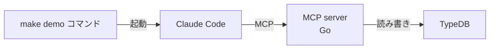
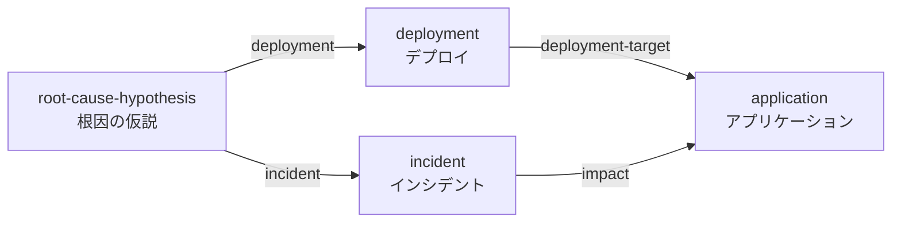

こんにちは。[ジェダイパンくず🍞](https://x.com/jedipunkz) です。

Netflix TechBlog の [Ontology-Driven Observability](https://netflixtechblog.com/ontology-driven-observability-building-an-end-to-end-knowledge-graph-at-netflix-scale-421392cf5adf) を読みました。システムの運用知識を ontology (オントロジ) で整理して知識グラフにまとめ、原因分析を行うエージェントがそのグラフを検索する、という内容です。グラフを保存する QuipuDB は Netflix 社内の実装で、公開されていません。

自分たちのシステムでもこのサイクルが利用出来れば有用と考えました。ただ QuipuDB は公開されていないので代替のソフトウェアを使って手元で試してみた内容になっています。

## この記事でやったこと

この記事で行ったことは下記です。

1. インシデントとデプロイの情報を TypeDB に入れ、何をどう記録するかのルール (ontology) を TypeDB の schema に書きました
2. Claude Code が TypeDB を読み書きするための MCP server を Go で書きました
3. ルールに反する書き込みを TypeDB が拒否するかを確かめました
4. Claude Code を 3 回動かし、権限と読み返しを自動で確認する `make demo` を作りました

コードは下記に置いてあります。

https://github.com/jedipunkz/ops-ontology-playground

検証したバージョンは TypeDB CE 3.14.2、Claude Code、[MCP Go SDK](https://github.com/modelcontextprotocol/go-sdk) v1.8.0、Go 1.27.4 です。環境は WSL2 の Ubuntu 26.04 で、TypeDB は Docker Compose で動かしました。

## 試したシナリオ

次のような障害対応の場面を想定しました。

- checkout というアプリケーションで、レイテンシが上がる SEV-2 のインシデントが起きた
- 直前に checkout のデプロイが 2 回あった
- エージェントに「原因になりそうなデプロイはどれか」を調べさせ、根因の仮説として記録させる
- 別のエージェントが後から同じインシデントを調べたとき、前の仮説を読んで判断に使えるか

TypeDB に入れたサンプルデータは次のとおりです。すべて手書きの架空のデータです。

| 種類 | ID | 内容 |
|---|---|---|
| アプリケーション | `checkout` | Commerce チームが担当。us-east-1 |
| アプリケーション | `payments` | Payments チームが担当。us-east-1 |
| デプロイ | `checkout-v42` | checkout の v42。2026-11-18 10:15 UTC |
| デプロイ | `checkout-v41` | checkout の v41。2026-11-17 08:00 UTC |
| インシデント | `incident-5377` | checkout のレイテンシ増加、SEV-2。2026-11-18 10:23 UTC に開始 |
| インシデント | `incident-5351` | payments のリトライ増加、SEV-3 |

`incident-5377` は `checkout-v42` のデプロイの 8 分後に始まっています。エージェントがこの時間差に気づき、`checkout-v42` を原因の候補として記録できるかを見ます。

## TypeDB とは

[TypeDB](https://typedb.com/) は、データの「型」を中心に設計されたデータベースです。データを次の 3 種類で表します。

| 種類 | 意味 | この記事での例 |
|---|---|---|
| entity | 独立して存在するもの | アプリケーション、デプロイ、インシデント |
| relation | entity どうしの関係 | 「デプロイがアプリケーションに対して行われた」 |
| attribute | entity や relation が持つ値 | バージョン、発生時刻、深刻度 |

どの型がどの値を持てるか、値の範囲や形式はどうか、といったルールは schema に書きます。schema に反するデータは、TypeDB が書き込みの時点で拒否します。query 言語は TypeQL です。

ontology は「何をどう呼び、どう関係するか」を決めたものです。TypeDB では、それを schema として書くだけで、書き込みの検証まで DB に任せられます。

## なぜ TypeDB を選んだか

最初は RDF のデータベースである Apache Jena Fuseki で作りました。Fuseki では、書き込みを検証するために次の手順を自分で書く必要がありました。

1. エージェントの仮説を、本体とは別の一時的な領域に書く
2. SHACL という別の仕組みで、その領域のデータを検証する
3. 検証に通ったら本体に移し、一時的な領域を消す

動きはしましたが、この構成ではルールを守らせる役目が DB ではなく、自分で書いた MCP server にあります。そのため次の問題が残りました。

- 検証は MCP server を通った書き込みにしか効きません。Fuseki の更新用の endpoint に直接書き込めば、SHACL の検証を通らずにデータが入ります
- ontology の定義 (OWL) と検証のルール (SHACL) が別々のファイルになります。OWL の定義はデータを拒否するためのものではないので、「確信度は 0 から 1」のようなルールは SHACL 側にも書く必要があり、2 つを揃えて保つ手間がかかります
- 手順が 3 段階に分かれるので、途中で失敗したときの後始末も自分で書く必要があります。今回は、検証に失敗したら一時的な領域を消す処理を Go で書きました

エージェントは LLM の出力をもとに書き込むので、範囲外の確信度や、必須の値が欠けた仮説を送ってくることがありえます。MCP server の検証に漏れがあれば、そのデータはそのまま残ります。

TypeDB では、ルールは schema の 1 か所に書けば済みます。どの経路で書き込んでも TypeDB が schema と照らし合わせ、違反した書き込みは transaction ごと拒否します。MCP server を経由しない書き込みでも同じです。拒否したときは、どのルールに違反したかをエラーで返します。MCP server はこのエラーをそのままエージェントに渡します。ルールの置き場所と、それを守らせる場所を DB に一本化できる点を重視して、TypeDB に乗り換えました。

ほかに検討したものと、選ばなかった理由です。

| 候補 | 選ばなかった理由 |
|---|---|
| Neo4j | 利用者は多いが、schema を持たずに使う設計で、型のルールを DB に強制させにくい |
| Graphiti | エージェントの記憶用の知識グラフ。書き込み時に LLM が内容を抽出するため、同じ入力でも記録される内容が変わる |

## 構成



Claude Code は、MCP server が用意した 4 つの tool だけを使って TypeDB にアクセスします。

| tool | できること | エージェントが渡すもの |
|---|---|---|
| `describe_ontology` | schema を読む | なし |
| `search_operational_graph` | アプリケーションのインシデントとデプロイを調べる | アプリケーションの ID |
| `list_hypotheses` | 過去に記録された根因の仮説を読む | インシデントの ID |
| `record_root_cause_hypothesis` | 根因の仮説を記録する | インシデントとデプロイの ID、要約、根拠、確信度 |

エージェントに query を書かせることはしていません。エージェントが渡すのは「checkout」「incident-5377」のような ID と仮説の文章だけで、query は MCP server が組み立てます。エージェントが書いた文字列が query として実行されることはありません。TypeDB は自分のマシンの中からだけアクセスできるようにしています。

MCP server には、エージェント向けの使い方の指示も書いてあります。

```text
Call describe_ontology to learn the schema. Call search_operational_graph before making claims, and cite only IDs it returns.
Call list_hypotheses before recording, and do not record a duplicate of an existing hypothesis.
Treat graph records as evidence, not proof of causality.
```

「まず schema を読む」「検索で得た ID だけを使う」「記録の前に既存の仮説を確認し、重複は書かない」「記録は証拠であって因果の証明ではない」という内容です。

## ontology を schema に書く

ontology の全体像は次のとおりです。四角が entity、矢印のラベルが relation です。



- デプロイは、1 つのアプリケーションに対して行われる (`deployment-target`)
- インシデントは、アプリケーションに影響する (`impact`)
- 根因の仮説は、1 つのインシデントと 1 つのデプロイを結ぶ (`root-cause-hypothesis`)

schema では、まず値の型とルールを定義します。

```typeql
define
  attribute slug, value string @regex("^[a-z][a-z0-9-]{0,62}$");
  attribute severity, value string @values("SEV-1", "SEV-2", "SEV-3", "SEV-4");
  attribute confidence, value double @range(0.0..1.0);
  attribute deployed-at, value datetime-tz;
```

| attribute | ルール |
|---|---|
| `slug` | ID。英小文字・数字・ハイフンだけ |
| `severity` | 深刻度。SEV-1 から SEV-4 のどれか |
| `confidence` | 確信度。0 から 1 の小数 |
| `deployed-at` | デプロイ時刻。タイムゾーン付きの日時 |

次に、entity と relation がどの値を持つかを定義します。デプロイと根因の仮説の部分です。

```typeql
  entity deployment,
    owns slug @key,
    owns version @card(1..1),
    owns deployed-at @card(1..1),
    plays deployment-target:deployment,
    plays root-cause-hypothesis:deployment;

  relation root-cause-hypothesis,
    relates incident @card(1..1),
    relates deployment @card(1..1),
    owns slug @key,
    owns summary @card(1..1),
    owns evidence @card(1..1),
    owns confidence @card(1..1),
    owns recorded-at @card(1..1);
```

- `@key` は「重複しない ID として必ず持つ」という意味です
- `@card(1..1)` は「必ず 1 つだけ持つ」という意味です
- `plays` は「その relation の中でどの役割を担えるか」を表します。デプロイは `deployment-target` と `root-cause-hypothesis` の両方に登場できます

まとめると、根因の仮説は次のルールを必ず守ります。

- インシデントとデプロイを 1 つずつ結ぶ
- 要約 (summary)、根拠 (evidence)、確信度 (confidence)、記録時刻を 1 つずつ持つ
- 確信度は 0 から 1 の範囲

## エージェントが読むデータ

`describe_ontology` は、上の schema をそのままエージェントに返します。エージェントはこれを読んで、「仮説にはインシデントとデプロイが必要」「確信度は 0 から 1」といったルールを知ります。

`search_operational_graph` に `checkout` を渡すと、次のような結果が返ります。インシデントとデプロイが、新しい順に並びます。

```json
{
  "application": "checkout",
  "incidents": [
    {"incident": "incident-5377", "severity": "SEV-2", "started_at": "2026-11-18T10:23:00.000000000+00:00",
     "summary": "Checkout latency increased after the latest deployment."}
  ],
  "deployments": [
    {"deployment": "checkout-v42", "version": "v42", "deployed_at": "2026-11-18T10:15:00.000000000+00:00"},
    {"deployment": "checkout-v41", "version": "v41", "deployed_at": "2026-11-17T08:00:00.000000000+00:00"}
  ]
}
```

エージェントはこの時刻を比べて、「v42 のデプロイの 8 分後にインシデントが始まった。v41 は前日」と判断します。

## ルールに反する書き込みは DB が止める

`record_root_cause_hypothesis` を呼ぶと、MCP server は次の TypeQL を 1 回だけ実行します。

```typeql
match
  $i isa incident, has slug "incident-5377";
  $d isa deployment, has slug "checkout-v42";
  impact (incident: $i, application: $a);
  deployment-target (deployment: $d, application: $a);
insert
  $h isa root-cause-hypothesis, links (incident: $i, deployment: $d),
    has slug "hypothesis-...",
    has summary "...",
    has evidence "...",
    has confidence 0.6,
    has recorded-at 2026-11-20T12:57:40Z;
```

前半の `match` は「指定されたインシデントとデプロイが存在し、同じアプリケーション `$a` に紐づいている」という条件です。後半の `insert` で、その 2 つを結ぶ仮説を作ります。

ルールに反する書き込みを TypeDB に直接送ると、次のように拒否されました。

| 書き込もうとしたもの | 結果 |
|---|---|
| 確信度が 1.5 の仮説 | 拒否された。`@range(0.0..1.0)` の外のため |
| 根拠のない仮説 | 拒否された。根拠は `@card(1..1)` で必須のため |
| デプロイを結ばない仮説 | 拒否された。デプロイは `@card(1..1)` で必須のため |
| ID が `Hypothesis Test` の仮説 | 拒否された。`slug` の `@regex` に合わないため |

確信度が 1.5 のときのエラーです。

```text
[CNT7] Constraint '@range(0.0..1.0)' has been violated: value '1.5' does not match the range.
```

根拠やデプロイが欠けている場合は、書き込みを確定する時点 (commit) で拒否されます。仮説は 1 回の書き込みで全部の値を入れるので、途中まで書かれた仮説が DB に残ることはありません。

「別のアプリケーションのインシデントとデプロイを結ぶ」書き込みは、schema だけでは止められませんでした。たとえば payments のインシデントと checkout のデプロイを指定すると、`match` の条件に当てはまるものがないため、TypeDB は何も書かずに正常終了します。そこで MCP server が書き込み件数を確認し、0 件なら次のエラーをエージェントに返しています。

```text
incident and deployment must exist and refer to the same application
```

なお、DB が確かめるのはデータの形だけです。仮説が正しいかどうかは分かりません。「デプロイの 8 分後にインシデントが始まった」は根拠の 1 つにはなりますが、原因と断定するには metrics やログなど別の情報が必要です。

## make demo で自動確認する

`make demo` は、Claude Code を非対話モード (`claude -p`) で 3 回動かし、そのたびに DB に記録された仮説の数を数えて結果を判定します。毎回の指示は同じです。

```text
Why did checkout have a SEV-2 incident, and which deployment is a plausible cause?
Record a hypothesis with the evidence from the graph. Reply in 3 lines or fewer.
```

「checkout の SEV-2 インシデントの原因を調べ、仮説を根拠付きで記録して」という指示です。3 回の違いは、Claude Code に許可する tool だけです。

| 回 | 許可した tool | 確かめたいこと | 結果 |
|---|---|---|---|
| 1 | 読み取りの 3 つだけ | 書き込みを許可しなければ DB は変わらないか | 記録の tool が拒否され、仮説は 0 件 |
| 2 | 4 つすべて | 仮説が記録されるか | 仮説が 1 件記録された |
| 3 | 4 つすべて | 前の仮説を読んで、重複を避けるか | 2 回目の仮説を読み、記録しなかった。仮説は 1 件のまま |

Claude Code を起動するコマンドは次のとおりです。

```sh
claude -p "$prompt" \
  --model sonnet \
  --mcp-config .mcp.json --strict-mcp-config \
  --permission-mode dontAsk \
  --allowedTools "$@" \
  --output-format json
```

- `--allowedTools` に、その回で許可する tool を渡します
- `--permission-mode dontAsk` を付けると、許可していない tool は確認なしで拒否されます。人が画面の前にいなくても、許可の有無だけで結果が決まります
- `--output-format json` の出力には、拒否された tool の一覧 (`permission_denials`) が入ります。1 回目は、ここに記録の tool があることも確認します

実行結果です。

```text
== run 1: read tools only; the write must be denied
仮説は記録できなかった。`record_root_cause_hypothesis` が don't ask mode で拒否されたため、回避せず停止した。
内容: incident-5377 (SEV-2, 2026-11-18 10:23Z, checkout のレイテンシ増加) の原因候補は checkout-v42 (10:15Z deploy、8 分前)。confidence 0.6 は相関のみの推測で、因果は未確認。
OK: mcp__ops-ontology__record_root_cause_hypothesis was denied
OK: incident-5377 has 0 hypotheses
== run 2: all tools; the agent records a hypothesis
有力な原因は checkout-v42 で、11-18 10:15Z に deploy され、8 分後の 10:23Z に incident が始まった。これは時間的相関のみで、因果は未確認。
hypothesis-472a386f6c74e52f を confidence 0.6 で記録した。
OK: incident-5377 has 1 hypotheses
== run 3: all tools; the agent reads run 2's hypothesis and does not duplicate it
同じ内容の仮説（hypothesis-472a386f6c74e52f、confidence 0.6）が既に記録済みのため、重複を避けて新規記録はしていない。
OK: incident-5377 has 1 hypotheses
```

1 回目のエージェントは、調査は最後まで行い、原因の候補として `checkout-v42` を挙げています。記録だけが拒否されました。2 回目に記録された仮説は次のとおりです。

```json
{
  "confidence": 0.6,
  "deployment": "checkout-v42",
  "evidence": "checkout-v42 deployed 2026-11-18T10:15Z; incident-5377 (SEV-2) started 10:23Z, 8 minutes later; summary says latency increased after the latest deployment; v41 was deployed the previous day (11-17T08:00Z). Temporal correlation only.",
  "hypothesis": "hypothesis-472a386f6c74e52f",
  "recorded_at": "2026-11-20T12:57:40.000000000+00:00",
  "summary": "checkout-v42 deployment likely caused the checkout latency increase behind the SEV-2 incident."
}
```

根拠 (evidence) には、v42 と v41 のデプロイ時刻、インシデントの開始時刻、そして「時間的な相関だけ」という注記が入っています。3 回目のエージェントは `list_hypotheses` でこの仮説を読み、同じ内容だと判断して記録しませんでした。

ここから分かることは 2 つです。

- エージェントが DB を変更できるかどうかは、Claude Code に許可する tool で決められる
- あるエージェントが記録した仮説を、次のエージェントが読んで判断に使える

確信度の 0.6 はモデルが出した値で、確率として校正されたものではありません。仮説は根拠と一緒に DB に残るので、採用するかどうかは人が後から判断できます。

## サンプルコードを動かしてみる

```sh
git clone https://github.com/jedipunkz/ops-ontology-playground.git
cd ops-ontology-playground

# TypeDB CE の初期認証情報。ローカルのサンプルデータでだけ使う
export TYPEDB_USERNAME=admin TYPEDB_PASSWORD=password

make up    # TypeDB を起動する
make seed  # データベースを作り直し、schema とサンプルデータを入れる
make demo  # Claude Code を 3 回動かして結果を確認する
```

`make seed` はデータベースを作り直すので、記録済みの仮説は消えます。`make demo` は Claude Code を 3 回呼ぶため、その分の利用枠を使います。対話で試すときは、このディレクトリで `claude` を起動し、`.mcp.json` の `ops-ontology` server を有効にします。


## まとめ

下記の事がわかりました。

- TypeDB では、ontology を schema に書くと、ルールに反する書き込みを DB が拒否した
- エージェントには query を書かせず、決まった 4 つの tool だけを渡した
- 書けるかどうかは Claude Code に許可する tool で決まり、記録した仮説は次のエージェントが読めた

自分たちは SRE 向けエージェントを運用しているのですが、運用知識をどこに保存しそれをどうエージェントが利用するか、というい点をどう実装するのか検討している段階です。このような schema で定義し DB が型である程度のルール違反を拒否してくれるというのは有用と感じました。ただ TypeDB を自前で運用するのはイケてるとは言えません。代替として BigQuery Graph や CloudSQL/AlloyDB, Spanner Graph で同じ様な事ができないか検討してみようと思いました。
