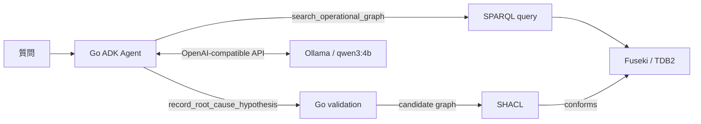

こんにちは。[ジェダイパンくず🍞](https://x.com/jedipunkz) です。

Netflix の [Ontology-Driven Observability](https://netflixtechblog.com/ontology-driven-observability-building-an-end-to-end-knowledge-graph-at-netflix-scale-421392cf5adf) という記事を読みました。メトリクス、ログ、トレース、デプロイ履歴、インシデント時の会話を、共通の語彙を持つ知識グラフに入れて、Agentic Root Cause Analysis（AutoRCA）から検索する仕組みです。

最初に気になったのは QuipuDB でした。Netflix はこれを自社製の RDF graph database、redb を基盤にした distributed quad store と説明しています。「これを Docker Compose で立ち上げて、手元の SRE Agent につないだら、どんな読み書きになるのだろう」と思いました。

## 先に結論

QuipuDB のソースコードやローカル起動手順は、Netflix の記事にはありません。そこで QuipuDB 自体を動かすのではなく、同じ考え方を Apache Jena Fuseki と RDF/OWL/SHACL/SPARQL で小さく作りました。

作ったものは [ops-ontology-playground](https://github.com/jedipunkz/ops-ontology-playground) です。Go ADK Agent が Fuseki から incident と deployment を検索し、根因の「仮説」を SHACL で検証してからグラフに記録します。LLM はローカル Ollama の `qwen3:4b` を使うので、Gemini API key も Google Cloud project も不要です。

| Netflix の構成 | 今回の playground |
|---|---|
| Observability Ontology | 小さな RDF/OWL の `ops` ontology |
| QuipuDB | Apache Jena Fuseki / TDB2 |
| enrichers と correlation engine | synthetic な Turtle データと SPARQL |
| AutoRCA の specialist agents | Go ADK の `llmagent` と function tools |
| incident discussion も含む運用データ | checkout の incident と deployment |

Netflix の production system を再現するものではありません。目的は、Agent が運用知識グラフをどう読むか、どういう制約を通して書くかをローカルで確かめることです。

## Ontology とグラフ DB は別のもの

記事を読む前は「QuipuDB がオントロジー DB なのかな」と考えていました。正確には、ontology は「何を Application、Incident、Deployment と呼び、それらがどう関係するか」というモデルです。RDF が事実を triple で表し、OWL で語彙や関係を定義し、SHACL でデータの形を検証し、SPARQL で検索します。QuipuDB はその RDF knowledge graph を保存する Netflix 内部の実装です。

例えば、運用上の事実を次のように書けます。

```turtle
@prefix ops: <https://example.com/ops#> .

ops:checkout a ops:Application ;
    ops:ownedBy "Commerce" ;
    ops:deployedIn "us-east-1" .

ops:incident-5377 a ops:Incident ;
    ops:affects ops:checkout ;
    ops:severity "SEV-2" ;
    ops:summary "Checkout latency increased after the latest deployment." .
```

「`incident-5377` が `checkout` に影響した」という関係は `ops:affects` の triple です。アプリケーションの ID が監視ツール、deploy tool、incident management tool で食い違うと、RCA の前に人間が名前の対応表を頭の中で作ることになります。Ontology は、その対応関係を機械が読める形で明示する役割を持ちます。

Netflix の記事では、Raw telemetry や incident discussion を typed triples に変換し、entity の型や命名、software catalog との照合を通してから graph に入れています。ログや Slack のテキストをそのまま LLM に渡すだけでなく、データの意味と制約をモデルにしておくのがポイントです。

## ローカル構成

今回の構成は次のとおりです。



- Fuseki 6.2.0 は RDF graph を TDB2 に保存します。
- Go ADK Agent は `search_operational_graph` と `record_root_cause_hypothesis` の 2 つの function tool を持ちます。
- Ollama は `qwen3:4b` をローカルで動かします。Agent の既定モデルをローカルにしたため、外部の API key は使いません。
- `docker compose` の port mapping と Ollama server は loopback に bind し、ネットワークへ公開しない構成です。

ADK Go の OpenAI-compatible model connector は experimental です。Ollama の OpenAI-compatible `/v1/chat/completions` endpoint を使い、コードでは `APIChatCompletions` を選びます。Ollama は local API key の値を認証には使わず無視します。ADK のクライアントには空でない値が必要なため、コード中の `"ollama"` は固定の dummy value です。秘密情報ではありません。

モデル設定は `internal/modelconfig/config.go` にまとめました。既定値は Ollama なので Gemini の key を読まず、Gemini を使う場合だけ `MODEL_PROVIDER=gemini` を明示します。

```go
llm, err := openaimodel.NewModel(ctx, modelName, &openaimodel.ClientConfig{
    APIKey:  "ollama", // Ollama local API ignores this placeholder.
    BaseURL: "http://127.0.0.1:11434/v1",
    API:     openaimodel.APIChatCompletions,
    HTTPClient: &http.Client{
        Timeout: 5 * time.Minute,
        CheckRedirect: func(_ *http.Request, _ []*http.Request) error {
            return http.ErrUseLastResponse
        },
    },
})
```

URL の host は `localhost` か loopback IP だけを許可しています。API key を空で送ると Go の OpenAI client が環境変数の値を参照するため、local endpoint に誤って別の key を送らないよう、loopback と redirect 無効化も設定しています。

## 試す

動作確認に使った修正は [ops-ontology-playground の PR #2](https://github.com/jedipunkz/ops-ontology-playground/pull/2) にあります。PR merge 前に試す場合は、`fix/fuseki-tdb2-config` branch を使います。merge 後は `main` で同じ手順を実行できます。

```sh
git clone --branch fix/fuseki-tdb2-config \
  https://github.com/jedipunkz/ops-ontology-playground.git
cd ops-ontology-playground
```

リポジトリの README にある手順では、Ollama と Fuseki を別々に起動します。

```sh
# Ollama server を別 terminal で起動した後
ollama pull qwen3:4b

# Fuseki を Docker Compose で起動
docker compose up --build -d

# ontology と synthetic data を投入
go run ./cmd/seed

# API key なしで Go ADK Agent を起動
go run ./cmd/agent console
```

この環境では Docker と Docker Compose を利用できませんでした。そのため今回の動作確認では、公式 Apache Jena Fuseki 6.2.0 binary と Temurin JRE を一時領域に展開し、`--localhost` で Fuseki を直接起動しました。`docker compose up` 自体はこの環境では実行していません。Fuseki のデータサービス設定、Go の seed client、Ollama、Agent の tool 呼び出しは実動作で確認しました。

Ollama と Fuseki はどちらも `127.0.0.1` だけに bind しました。Fuseki のサンプルには認証がないため、port を外部 network に公開してはいけません。

## グラフに入れたデータ

`ontology/observability.ttl` で `Application`、`Deployment`、`Incident`、`Hypothesis` とその関係を定義し、`ontology/sample-ops.ttl` に試験データを入れました。

```turtle
ops:checkout-v42 a ops:Deployment ;
    ops:target ops:checkout ;
    ops:version "v42" ;
    ops:deployedAt "2026-11-18T10:15:00Z"^^xsd:dateTime .

ops:incident-5377 a ops:Incident ;
    ops:affects ops:checkout ;
    ops:severity "SEV-2" ;
    ops:summary "Checkout latency increased after the latest deployment." ;
    ops:startedAt "2026-11-18T10:23:00Z"^^xsd:dateTime .
```

実データではなく、動きが分かるように作った synthetic data です。`incident-5377` は `checkout-v42` の 8 分後に始まっています。`checkout-v41` も入れてあり、「最新 deployment」と「前の deployment」を SPARQL で並べられます。

Agent の検索 tool は LLM に自由な SPARQL を書かせません。`checkout` のような lowercase slug を受け取り、Go 側で固定 query を組み立てます。検索結果には incident の `startedAt` と deployment の `deployedAt` を含めます。

```sparql
PREFIX ops: <https://example.com/ops#>
SELECT ?incident ?severity ?incidentSummary ?incidentStartedAt
       ?deployment ?version ?deployedAt
WHERE {
  ops:checkout a ops:Application .
  OPTIONAL {
    ?incident a ops:Incident ;
              ops:affects ops:checkout ;
              ops:severity ?severity ;
              ops:summary ?incidentSummary ;
              ops:startedAt ?incidentStartedAt .
  }
  OPTIONAL {
    ?deployment a ops:Deployment ;
                ops:target ops:checkout ;
                ops:version ?version ;
                ops:deployedAt ?deployedAt .
  }
}
ORDER BY DESC(?deployedAt)
LIMIT 100
```

この query の結果から Agent は次の情報を受け取ります。

| Entity | 値 |
|---|---|
| Incident | `incident-5377`, `SEV-2`, 10:23 UTC |
| 最新 deployment | `checkout-v42`, 10:15 UTC |
| 前の deployment | `checkout-v41`, 前日 08:00 UTC |

ADK の function tool は Go の関数から作ります。LLM に渡すのは `application` という slug だけで、SPARQL の組み立ては `SearchApplication` が担当します。

```go
searchTool, err := functiontool.New(
    functiontool.Config{
        Name:        "search_operational_graph",
        Description: "Find incidents and deployments connected to an application.",
    },
    func(ctx agent.Context, args SearchArgs) (map[string]any, error) {
        result, err := graphClient.SearchApplication(ctx, args.Application)
        if err != nil {
            return nil, err
        }
        return map[string]any{"bindings": result.Results.Bindings}, nil
    },
)
```

`SearchApplication` は slug を `^[a-z][a-z0-9-]{0,62}$` に制限し、SPARQL query に `LIMIT 100` を付けます。LLM が SPARQL syntax を誤るケースを減らし、任意 query の実行権限も与えません。

最初の実行では、こちらが user prompt に「8 分後」と書いてしまいました。それでは Agent が時間差をグラフから読み取った証拠になりません。また初版の検索 tool は `startedAt` を返していませんでした。そこで検索 tool に incident の開始時刻を追加し、別の空データベースに seed し直して、時間差を指示しない prompt で再実行しました。

ここは記事を書く上でも大事な確認でした。LLM に正解を教えた上で tool call が成功したことと、LLM がグラフから答えを得たことは別です。

### 実行した環境

今回の確認に使ったバージョンは Go 1.27.3、ADK Go v2.8.0、Apache Jena Fuseki 6.2.0、Temurin JRE 21.0.13.1、Ollama 0.40.16、`qwen3:4b`（Q4_K_M）です。`GOOGLE_API_KEY` を unset した状態で agent を起動しました。

この実行環境には Docker がなく、AMD GPU もこの session に device として公開されていませんでした。`/dev/kfd` と `/dev/dri` がなく、`ollama ps` は `100% CPU` を表示しました。そのため、Fuseki は公式 binary を一時領域に展開して直接起動し、Ollama は公式 Linux archive を checksum 検証後に一時領域で起動しました。**AMD GPU の利用と Docker Compose の起動は未確認**です。

新規の Fuseki data directory で seed し直し、Agent を次の 2 turn で動かしました。

1. checkout の遅延を調べるが、まだ仮説は記録しない。
2. 検索結果の incident/deployment ID と時刻だけを使って、confidence 0.75 の仮説を記録する。検索結果に時刻がなければ記録しない。

起動時には `GOOGLE_API_KEY` を明示的に外しました。実際に使った Agent 起動コマンドは次のとおりです。

```sh
env -u GOOGLE_API_KEY \
  FUSEKI_URL=http://127.0.0.1:3031/ops \
  go run ./cmd/agent console
```

最初の応答には `incident-5377` の開始時刻 `2026-11-18T10:23:00Z` と、`checkout-v42` の deploy 時刻 `2026-11-18T10:15:00Z` が出て、Agent は「8 分後」と計算しました。次の応答では `hypothesis-f0996e03-3050-471b-866e-2699892871ad` を記録したと返しました。

応答文だけでは、書き込みが実データに反映された証拠になりません。Agent 実行後に SPARQL `ASK` で hypothesis、incident、deployment、confidence、summary、evidence を照合し、`true` を確認しました。さらに SHACL endpoint の report は `sh:conforms true`、named graph 検索では staging graph が 0 件でした。

## Agent の読み取りと書き込み

Agent にはまず「調べて、根拠を述べるが、まだ仮説は記録しない」と頼み、その後で「検索結果だけを使って仮説を記録して」と頼みました。実際の応答では、Agent が `incident-5377` と `checkout-v42` の時刻を検索結果から読み、差が 8 分であることを述べました。

> `incident-5377` は `checkout-v42` がデプロイされた後、8 分後に開始された遅延インシデントを示しています。

Agent は続く tool call で以下の内容を記録しました。

```text
Hypothesis ID: hypothesis-f0996e03-3050-471b-866e-2699892871ad
Incident ID: incident-5377
Deployment ID: checkout-v42
Evidence: Incident started 8 minutes after checkout-v42 deployment
Confidence: 0.75
```

Confidence はモデルが出した値で、校正済み確率ではありません。`0.75` と記録されていても「根因である確率が実験的に 75%」という意味にはなりません。仮説と根拠を graph に残し、人間が後から判断できるようにするものです。

### 書き込みをそのまま通さない

グラフへの書き込みは、LLM が生成した任意の SPARQL をそのまま実行する設計にはしていません。`record_root_cause_hypothesis` は構造化された値を受け取り、次の順で処理します。

1. incident ID と deployment ID が slug 形式か確認する。
2. confidence が 0〜1 の範囲で、summary と evidence が長さ制限内か確認する。
3. SPARQL `ASK` で incident と deployment が存在し、同じ application に紐付くか確認する。
4. 候補 triple を一時 named graph に書く。
5. SHACL で必須 field、datatype、confidence の範囲を検証する。
6. `sh:conforms true` の場合だけ default graph に promote し、一時 graph を削除する。

今回の shape では `aboutIncident` と `relatedDeployment` をそれぞれ 1 つ必須にし、summary/evidence の長さ、confidence の datatype と 0〜1 の範囲、recordedAt の dateTime 型を検証します。

```turtle
ops:HypothesisShape a sh:NodeShape ;
    sh:targetClass ops:Hypothesis ;
    sh:property [
        sh:path ops:confidence ;
        sh:minCount 1 ;
        sh:maxCount 1 ;
        sh:datatype xsd:decimal ;
        sh:minInclusive 0 ;
        sh:maxInclusive 1
    ] ;
    sh:property [
        sh:path ops:aboutIncident ;
        sh:minCount 1 ;
        sh:maxCount 1 ;
        sh:class ops:Incident
    ] .
```

検証が失敗した場合は、一時 graph を削除して default graph へ promote しません。実行後に named graph を検索し、`urn:ops-ontology:staging:` の graph が残っていないことも確認しました。

SHACL が確認するのはデータの形です。deployment が incident の原因であることを証明するわけではありません。時刻の前後関係や `ops:affects` は仮説の根拠になりますが、因果関係の確定には metrics、logs、traces、変更内容など別の観測が要ります。

## 実行で見つかった実装ミス

初回の Fuseki 起動は失敗しました。例外は `NoSpecificTypeException` で、設定中の `ja:DatasetTDB2` が Jena 6.2.0 の assembler type として解決されませんでした。公式の Jena 6 設定では TDB2 dataset の型は `tdb2:DatasetTDB2`、保存先は `tdb2:location` です。設定を修正すると Fuseki が起動しました。

次に `cmd/seed` が 405 を受けました。Graph Store URL は `/ops/data?default` であるべきですが、client が `?default` を path として連結して `/ops/data%3Fdefault` にしていました。endpoint path と query string を分けて URL を組み立てるよう修正しました。

最後に検索 tool が `startedAt` を返さない問題を直しました。単に LLM の instruction に「時間差を計算する」と書いても、必要な値が tool response に存在しなければ graph-grounded な推論にはなりません。tool の戻り値に必要な facts が含まれているかもテスト対象にしました。

これらの修正は [ops-ontology-playground の PR #2](https://github.com/jedipunkz/ops-ontology-playground/pull/2) にまとめています。PR が merge されるまでは、再現する場合にこの branch を使ってください。

## Netflix の QuipuDB と同じではない

この playground から分かるのは、Ontology を Agent の境界に置き、検索と書き込みを型・検証付きにする基本パターンです。次のものは再現していません。

- QuipuDB の分散 quad store と Netflix の scale
- Netflix の 12 operational namespaces や production software catalog
- Atlas、Radar、Spinnaker、incident management、Slack などからのデータ収集
- enrichers、correlation engine、AutoRCA の specialist agents
- production workload の性能、可用性、権限設計

QuipuDB を Compose で起動できたわけではありません。公開されている W3C 標準と Apache Jena で「同じ設計の一部」を試したものです。Jena Fuseki は TDB2 の SPARQL server であり、QuipuDB の代替実装や互換層ではありません。

## まとめ

Ontology-Driven Observability の中心は、単に graph database を導入することではありません。Application、Incident、Deployment、Team の意味と関係を定義し、複数の運用システムから来る情報を同じ語彙で検索できるようにすることです。

手元の sample では Go ADK Agent が運用グラフを読み、時刻差を根拠として仮説を書き、SHACL が形を検証しました。モデルが出した仮説は未確認のまま残し、人間が graph 上の根拠を追えます。

QuipuDB の内部実装は動かせませんでした。それでも標準化された RDF/OWL/SHACL/SPARQL と local model を使えば、記事の設計パターンを小さな実験に落とし込めます。次に試すなら、OpenTelemetry の trace と deploy 情報を取り込み、SPARQL の relation を実際の計測値と incident に結び付けたいです。

## 参考資料

- [Netflix TechBlog: Ontology-Driven Observability](https://netflixtechblog.com/ontology-driven-observability-building-an-end-to-end-knowledge-graph-at-netflix-scale-421392cf5adf)
- [Apache Jena: Fuseki configuration](https://jena.apache.org/documentation/fuseki2/fuseki-configuration.html)
- [Apache Jena: TDB2 with Fuseki](https://jena.apache.org/documentation/tdb2/tdb2_fuseki.html)
- [Apache Jena: SHACL](https://jena.apache.org/documentation/shacl)
- [ADK Go OpenAI-compatible model connector](https://adk.dev/agents/models/openai/)
- [Ollama OpenAI-compatible API](https://docs.ollama.com/api/openai-compatibility)
- [Ollama Qwen3 models](https://ollama.com/library/qwen3)
