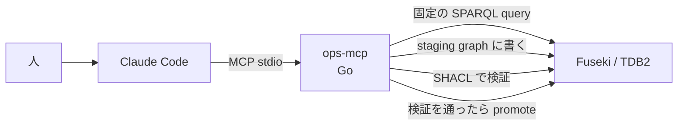

こんにちは。[ジェダイパンくず🍞](https://x.com/jedipunkz) です。

Netflix TechBlog の [Ontology-Driven Observability](https://netflixtechblog.com/ontology-driven-observability-building-an-end-to-end-knowledge-graph-at-netflix-scale-421392cf5adf) を読みました。運用データを共通の語彙 (ontology) を持つ知識グラフにまとめ、根因分析をするエージェントがそのグラフを検索する、という内容です。グラフを保存する QuipuDB は Netflix 社内の実装で、公開されていません。

そこで同じ考え方を、公開されている標準と OSS で小さく作りました。グラフの保存には Apache Jena Fuseki、語彙には RDF/OWL、書き込みの検証には SHACL を使いました。エージェントには Claude Code を使い、Go で書いた MCP server を経由してグラフを読み書きさせています。

動作確認のために書いたコードは下記に置いてあります。

https://github.com/jedipunkz/ops-ontology-playground

検証したバージョンは Apache Jena Fuseki 6.2.0、[MCP Go SDK](https://github.com/modelcontextprotocol/go-sdk) v1.8.0、Claude Code 2.1.325、Go 1.27.4 です。環境は WSL2 の Ubuntu 26.04 で、Fuseki は Docker Compose (Docker 29.1.3、Compose 2.40.3) で動かしました。

## 作ったもの

エージェントは次の 3 つのことをします。

1. グラフから ontology を読み、どんな型と関係があるかを知る
2. インシデントとデプロイを検索し、根因の仮説を立てる
3. 仮説をグラフに書き込む。書き込みは SHACL の検証を通ったものだけが入る

書き込んだ仮説は、次に調査するエージェントが読めます。2 回目のエージェントは前回の仮説を見つけ、同じ仮説を重複して書きませんでした。

| Netflix の記事 | この playground |
|---|---|
| Observability の ontology | 小さな RDF/OWL の `ops` ontology |
| QuipuDB | Apache Jena Fuseki (TDB2) |
| 運用システムからのデータ収集 | 手書きの Turtle ファイル (synthetic data) |
| 根因分析のエージェント | Claude Code と MCP server |

Netflix の production system を再現するものではありません。確かめたかったのは、エージェントが運用知識グラフをどう読み、どういう制約を通して書くかです。

## Ontology と RDF/OWL/SHACL

ontology は「何を Application、Incident、Deployment と呼び、それらがどう関係するか」を定めたモデルです。今回使った W3C の標準は、それぞれ次の役割を持ちます。

| 標準 | 役割 |
|---|---|
| RDF | 事実を「主語・述語・目的語」の triple で表す |
| OWL | クラスと property (関係) を定義する |
| SHACL | データが満たすべき形 (必須の property、型、値の範囲) を定義し、検証する |
| SPARQL | グラフを検索・更新する |

運用上の事実は Turtle 形式で次のように書きます。

```turtle
@prefix ops: <https://example.com/ops#> .
@prefix xsd: <http://www.w3.org/2001/XMLSchema#> .

ops:checkout-v42 a ops:Deployment ;
    ops:target ops:checkout ;
    ops:version "v42" ;
    ops:deployedAt "2026-11-18T10:15:00Z"^^xsd:dateTime .

ops:incident-5377 a ops:Incident ;
    ops:affects ops:checkout ;
    ops:severity "SEV-2" ;
    ops:summary "Checkout latency increased after the latest deployment." ;
    ops:startedAt "2026-11-18T10:23:00Z"^^xsd:dateTime .
```

「`incident-5377` は `checkout` に影響した」は `ops:affects` の triple 1 つです。監視ツール、デプロイツール、インシデント管理ツールでアプリケーションの名前が食い違うと、調査する人はまず名前の対応を頭の中で作ることになります。ontology があれば、その対応を機械が読める形で持てます。

### なぜ RDB や Neo4j ではなく Fuseki か

データを入れるだけなら、RDB でも Neo4j でもできます。今回 Fuseki を選んだ理由は次の 2 つです。

1. ontology (スキーマ) 自体がグラフ内のデータです。エージェントは SPARQL で ontology を検索して、どんな型と関係があるかを知れます。プロンプトにスキーマを書く必要がありません
2. Fuseki は SHACL の検証を endpoint として標準で持っています。エージェントの書き込みを検証する仕組みを、別のツールを足さずに作れます

Neo4j は property graph のデータベースで、RDF の取り込みや SHACL の検証はプラグイン (neosemantics) で行います。LLM が Cypher を書くことに慣れている点は Neo4j の利点です。ただ、今回はエージェントに query を書かせない設計にしたため、その利点は使いません。

## 構成



- Fuseki は `127.0.0.1:3030` だけで待ち受けます。サンプルには認証がないため、外部のネットワークに公開してはいけません
- `ops-mcp` は stdio で動く MCP server です。Claude Code が子プロセスとして起動します
- MCP server は loopback の Fuseki URL しか受け付けません

MCP server が持つ tool は 4 つです。

| tool | 種類 | 内容 |
|---|---|---|
| `describe_ontology` | 読み | ontology のクラスと property を返す |
| `search_operational_graph` | 読み | application に紐づくインシデントとデプロイを返す |
| `list_hypotheses` | 読み | インシデントに対して記録済みの仮説を返す |
| `record_root_cause_hypothesis` | 書き | 仮説を検証してから記録する |

どの tool もエージェントから SPARQL を受け取りません。エージェントが渡すのは `checkout` や `incident-5377` のような slug と、仮説の本文だけです。query は Go 側で組み立てます。

## 試す

```sh
git clone https://github.com/jedipunkz/ops-ontology-playground.git
cd ops-ontology-playground

# Fuseki を起動する
make up

# ontology と synthetic data を投入する
make seed

# Claude Code を起動する。.mcp.json の ops-ontology server を有効にするか聞かれる
claude
```

`.mcp.json` には MCP server の起動方法を書いてあります。

```json
{
  "mcpServers": {
    "ops-ontology": {
      "command": "go",
      "args": ["run", "./cmd/ops-mcp"],
      "env": {
        "FUSEKI_URL": "http://127.0.0.1:3030/ops"
      }
    }
  }
}
```

Claude Code には次のように頼みます。

```text
Why did checkout have a SEV-2 incident, and which deployment is a plausible cause?
Record a hypothesis with the evidence from the graph.
```

## 読む: ontology と運用データ

エージェントが最初に呼んだのは `describe_ontology` でした。この tool は次の SPARQL で、`ops` namespace のクラスと property を返します。

```sparql
PREFIX ops:  <https://example.com/ops#>
PREFIX owl:  <http://www.w3.org/2002/07/owl#>
PREFIX rdfs: <http://www.w3.org/2000/01/rdf-schema#>
SELECT ?term ?kind ?label ?domain ?range
WHERE {
  VALUES ?kind { owl:Class owl:ObjectProperty owl:DatatypeProperty }
  ?term a ?kind .
  FILTER(STRSTARTS(STR(?term), STR(ops:)))
  OPTIONAL { ?term rdfs:label ?label }
  OPTIONAL { ?term rdfs:domain ?domain }
  OPTIONAL { ?term rdfs:range ?range }
}
ORDER BY ?kind ?term
LIMIT 200
```

今回の ontology では 18 件 (クラス 4 つと property 14 個) が返ります。エージェントはここで `Incident` が `affects` で `Application` を指し、`Deployment` が `target` で `Application` を指すことを知ります。

次に `search_operational_graph` で `checkout` を検索しました。MCP server の tool 定義は次のとおりです。`ReadOnlyHint` を付けて、この tool がグラフを変更しないことを client に伝えています。

```go
mcp.AddTool(server, &mcp.Tool{
    Name:        "search_operational_graph",
    Description: "Find incidents and deployments connected to a known application in the operational knowledge graph.",
    Annotations: readOnly,
}, func(ctx context.Context, _ *mcp.CallToolRequest, in SearchInput) (*mcp.CallToolResult, SearchOutput, error) {
    result, err := client.SearchApplication(ctx, in.Application)
    if err != nil {
        return nil, SearchOutput{}, err
    }
    return nil, SearchOutput{Application: in.Application, Rows: flatten(result)}, nil
})
```

`SearchApplication` は引数を `^[a-z][a-z0-9-]{0,62}$` に一致する slug に制限し、固定の query に埋め込みます。そのため、引数に SPARQL を混ぜ込むことはできません。検索結果から、エージェントは次の情報を得ます。

| Entity | 値 |
|---|---|
| Incident | `incident-5377`、`SEV-2`、2026-11-18 10:23 UTC に開始 |
| 最新の deployment | `checkout-v42`、10:15 UTC |
| 1 つ前の deployment | `checkout-v41`、前日 08:00 UTC |

## 書く: staging graph と SHACL

`record_root_cause_hypothesis` は、仮説を次の順に処理します。

1. incident ID と deployment ID が slug か、confidence が 0 から 1 の範囲か、本文が長さの制限内かを Go で確認する
2. SPARQL の `ASK` で、incident と deployment が存在し、同じ application を指しているかを確認する
3. 仮説の triple を一時的な named graph (staging graph) に書く
4. Fuseki の SHACL endpoint で staging graph を検証する
5. 検証を通ったら default graph に移し、staging graph を消す。通らなければ staging graph を消して終わる

SHACL の shape では、仮説が持つべき property と型を定義しています。一部を抜粋します。

```turtle
ops:HypothesisShape a sh:NodeShape ;
    sh:targetClass ops:Hypothesis ;
    sh:property [
        sh:path ops:aboutIncident ;
        sh:minCount 1 ;
        sh:maxCount 1 ;
        sh:class ops:Incident
    ] ;
    sh:property [
        sh:path ops:confidence ;
        sh:minCount 1 ;
        sh:maxCount 1 ;
        sh:datatype xsd:decimal ;
        sh:minInclusive 0 ;
        sh:maxInclusive 1
    ] .
```

いきなり default graph に書かず staging graph を経由するのは、検証に通らなかった仮説を他のエージェントや人に読ませないためです。

別の application の incident と deployment を組み合わせると、2 の確認で拒否されます。`checkout` の deployment と `payments` の incident を渡したときの tool の応答です。

```json
{"content":[{"type":"text","text":"incident and deployment must exist and refer to the same application"}],"isError":true}
```

SHACL が確認するのはデータの形だけです。仮説が正しいかどうかは確認しません。時刻の前後関係は仮説の根拠になりますが、因果を確かめるには metrics、ログ、trace、変更の差分といった別の観測が必要です。

## 読み返す: 前回の仮説を使う

同じ質問で Claude Code を 2 回実行しました。確認には headless モードを使い、MCP server の tool をすべて許可しています。

```sh
claude -p --model sonnet \
  --mcp-config .mcp.json --strict-mcp-config \
  --allowedTools 'mcp__ops-ontology__*' \
  "Why did checkout have a SEV-2 incident, and which deployment is a plausible cause? Record a hypothesis with the evidence from the graph. ..."
```

1 回目に呼ばれた tool と応答です。

```text
ツール呼び出し順: describe_ontology → search_operational_graph(checkout) → list_hypotheses(incident-5377、既存なし) → record_root_cause_hypothesis
hypothesis_id: hypothesis-ef9b3cb4-cb14-452a-a65c-ecfcc3dc7b19（incident-5377 × checkout-v42、confidence 0.6）
根拠: v42 は 2026-11-18T10:15Z に deploy され、8 分後の 10:23Z に SEV-2 が発生した。v41 は約 26 時間前。
注意: 時間的近接のみで、graph に metrics や diff はない。因果は未確認。
```

2 回目の応答です。

```text
呼び出し順: describe_ontology → search_operational_graph(checkout) → list_hypotheses(incident-5377)。
記録なし。incident-5377 に checkout-v42 の同一仮説（confidence 0.6）が既に存在し、重複になるため。
既存 ID: hypothesis-ef9b3cb4-cb14-452a-a65c-ecfcc3dc7b19
```

2 回目のエージェントは `list_hypotheses` で 1 回目の仮説を読み、書き込みをしませんでした。MCP server の instructions に「記録する前に `list_hypotheses` を呼び、既存の仮説と重複するものは記録しない」と書いてあるためです。グラフはエージェント同士が調査結果を受け渡す場所としても使えます。

confidence の 0.6 はモデルが出した値で、校正された確率ではありません。グラフに残しておけば、仮説を採用するかどうかを人が後から根拠と一緒に判断できます。

## 人の確認を挟む

<!-- TODO: 対話モードの Claude Code で、書き込み tool の実行前に許可確認が出るか、読み取り tool では出ないかを確認してから書く -->

書き込み tool には `ReadOnlyHint` を付けていません。MCP の client はこの annotation を見て、書き込み tool の実行前に人の確認を求められます。

## ローカル LLM をやめた経緯

最初は Google の ADK for Go でエージェントを書き、LLM には Ollama でローカルの `qwen3:4b` を使っていました。API key なしで手元だけで完結させたかったためです。

ところが手元の環境では Ollama が GPU を使えず、CPU で推論していました (`ollama ps` の VRAM 使用量が 0)。推論中はマシン全体が重くなり、tool 呼び出しが最後まで安定して動くかも確かめきれませんでした。

記事で見せたいのはグラフへの読み書きの制約で、エージェントの実装ではありません。そこで tool を MCP server として公開し、エージェント役を Claude Code に任せる構成に変えました。MCP server は MCP に対応した他の client からも使えます。

## 再現していないもの

- QuipuDB の実装と Netflix の規模
- 実際の運用システム (監視、デプロイ、インシデント管理など) からのデータ収集。今回のデータは手書きの synthetic data です
- 複数の専門エージェントによる根因分析
- 本番運用で必要な認証、権限設計、可用性

Fuseki は SPARQL server で、QuipuDB の代替実装でも互換層でもありません。

## まとめ

Ontology-Driven Observability で大事なのは、graph database を入れること自体ではありません。運用データの意味と関係を ontology で定義し、別々のシステムから来る情報を同じ語彙で引けるようにすることです。

手元の playground では、エージェントが ontology を読んでからグラフを検索し、根拠付きの仮説を SHACL の検証を通して書き込みました。次のエージェントはその仮説を読んで、重複した記録を避けました。エージェントには SPARQL を書かせず、型の決まった tool だけを渡しています。こうすると、エージェントが読み書きできる範囲をコードと SHACL の shape で決められます。

次は OpenTelemetry の trace とデプロイの履歴を自動でグラフに取り込み、synthetic data ではない入力で試してみたいです。

## 参考資料

- [Netflix TechBlog: Ontology-Driven Observability](https://netflixtechblog.com/ontology-driven-observability-building-an-end-to-end-knowledge-graph-at-netflix-scale-421392cf5adf)
- [Apache Jena: Fuseki configuration](https://jena.apache.org/documentation/fuseki2/fuseki-configuration.html)
- [Apache Jena: SHACL](https://jena.apache.org/documentation/shacl)
- [MCP Go SDK](https://github.com/modelcontextprotocol/go-sdk)
- [Claude Code: MCP](https://code.claude.com/docs/en/mcp)
