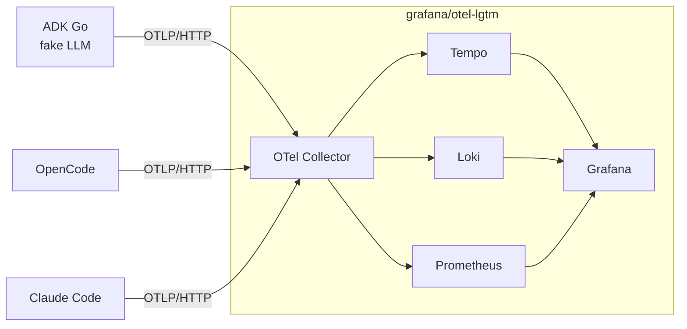

こんにちは。[ジェダイパンくず🍞](https://x.com/jedipunkz) です。

AI エージェントに作業を任せる時間が増えるほど、「いま何に時間がかかっているのか」「どの tool を何回呼んだのか」「token とお金をどれだけ使ったのか」が気になってきます。Hacker News でも [LLM Observability in the Wild – Why OpenTelemetry Should Be the Standard](https://news.ycombinator.com/item?id=45398467) というスレッドで、LLM アプリの可観測性を OpenTelemetry (OTel) に寄せるべきかが議論されていました。「エージェントの処理は tool 呼び出しを含む分散コールグラフなので OTel に向いている」という意見がある一方、「属性を足すだけではマルチエージェントのデバッグには足りない」という声もあります。

OTel には生成 AI 向けの semantic conventions (以下 GenAI semconv) があり、普段使っている Claude Code、OpenCode、そして以前の記事 [Google ADK Go 2.x の Dynamic Workflow とその為のガードレール](/post/adk-go-dynamic-loop/) で触った Google ADK Go も OTel の出力に対応しています。ただ、どれも「OTel 対応」とだけ書かれていて、実際に何が出てくるのか、互いに比較できる形なのかは分かりませんでした。そこで 3 つを同じ backend に流して比べてみました。

コードは下記に置いてあります。

https://github.com/jedipunkz/otel-genai-playground

## 結論

| エージェント | GenAI semconv との距離 | 対応 |
|---|---|---|
| ADK Go | ほぼ準拠。semconv v1.44 の span 名・属性がそのまま出る | traces, logs |
| OpenCode | 属性だけ準拠。span 名は内部の関数名で、`gen_ai.operation.name` が無い | traces, logs |
| Claude Code | 独自の `claude_code.*` スキーマに `gen_ai.*` 属性を追加した形。token 数は独自名 | traces (beta), metrics, logs |

3 つとも OTLP で出せるので、backend を 1 つにそろえるだけで「LLM 呼び出しのレイテンシ p95」「tool ごとの呼び出し回数と遅延」を同じ TraceQL で横断して見られました。一方で token 数の属性名や `finish_reasons` の値はエージェントごとにばらばらで、そのまま集計できるのは一部だけです。GenAI semconv はまだ Development ステータスなので注意が必要と思いました。

## OTel GenAI semantic conventions の現状

GenAI semconv は 2024 年に発足した GenAI SIG で作られている規約らしいです。当初の対象は LLM 呼び出しでしたが、今はエージェント、tool 呼び出し、MCP、評価結果まで範囲が広がっています。

そもそも semantic conventions とは何かというと、telemetry の「中身の名前の付け方」を決めた規約です。OTel の SDK や OTLP が決めているのは「どう集めて、どう送るか」までで、span にどんな名前を付け、属性をどんなキーで、どんな値で入れるかは決めていません。そこを決めているのが semconv です。

たとえば「LLM に入力した token 数」は、何も決めなければ実装ごとに `input_tokens`、`prompt_tokens`、`usage.input` のように名前が割れます。GenAI semconv はこれを `gen_ai.usage.input_tokens` という名前にし、cache から読んだ token も含めた値を入れる、と決めています。名前と意味がそろっていれば、どのエージェントが出した telemetry でも同じクエリで集計できます。逆にそろっていなければ、エージェントごとにクエリを書き分けることになります。この記事で「semconv に沿っているか」を気にするのはそのためです。

エージェントを観測するときに知りたいことと、semconv でそれに答える属性の対応は次のとおりです。この記事では、3 つのエージェントがこれらの属性を出しているかどうかを物差しにして比べます。

| 観測できる内容 | semconv の属性 | 補足 |
|---|---|---|
| この span は何の処理か | `gen_ai.operation.name` | 値は `generate_content` (LLM 呼び出し)、`execute_tool` (tool 実行)、`invoke_agent` (エージェント実行) など。span 名は `{operation} {対象名}` にする |
| どのモデルを呼んだか | `gen_ai.provider.name`、`gen_ai.request.model` | `gen_ai.provider.name` は必須で、古い `gen_ai.system` を置き換えるもの |
| どの tool を呼んだか | `gen_ai.tool.name`、`gen_ai.tool.call.id` | `execute_tool` の span に付ける |
| token をどれだけ使ったか | `gen_ai.usage.input_tokens`、`gen_ai.usage.output_tokens` | エージェントごとに名前と意味がずれやすい項目 (後述) |
| どのセッションの処理か | `gen_ai.conversation.id` | 複数の trace をセッション単位で束ねる |
| 何を送って何が返ってきたか | `gen_ai.input.messages`、`gen_ai.output.messages`、`gen_ai.system_instructions` | Opt-In。機密情報を含みうるので既定では記録しない |

## サンプル環境の構成

backend は [grafana/otel-lgtm](https://github.com/grafana/docker-otel-lgtm) を使いました。OTel Collector、Tempo (traces)、Loki (logs)、Prometheus (metrics)、Grafana が 1 コンテナに入っているので、Claude Code の 3 種類の signal を 1 コンテナで受けられます。



| パス | 内容 |
|---|---|
| `compose.yaml` | otel-lgtm。ポートは `127.0.0.1` にだけ bind |
| `adk-go/` | fake LLM で動く ADK エージェント |
| `opencode/run.sh` | OTLP export を有効にして OpenCode を 1 回実行 |
| `claude-code/run.sh` | OTel export を有効にして Claude Code を 1 回実行 |
| `grafana/dashboards/ai-agents.json` | 横断ダッシュボード |
| `workspace/weather.txt` | エージェントに読ませるファイル |

ファイル: `compose.yaml`

```yaml
services:
  lgtm:
    # Grafana + OTel Collector + Tempo (traces) + Loki (logs) + Prometheus (metrics) in one container.
    image: grafana/otel-lgtm:0.38.1
    ports:
      # Bind to localhost only: anonymous admin Grafana and unauthenticated OTLP receivers.
      - "127.0.0.1:3000:3000" # Grafana
      - "127.0.0.1:4317:4317" # OTLP gRPC
      - "127.0.0.1:4318:4318" # OTLP HTTP
    volumes:
      - ./grafana/dashboards:/otel-lgtm/grafana/conf/provisioning/dashboards/custom:ro
      - ./grafana/dashboards.yaml:/otel-lgtm/grafana/conf/provisioning/dashboards/custom.yaml:ro
```

otel-lgtm の Grafana は匿名 admin で動き、OTLP receiver にも認証がありません。プロンプトや tool 引数が流れ込む可能性もあるので、ポートは localhost に限定しています。

3 つとも「`weather.txt` (ADK は `get_weather` 関数) を tool で読んで、東京の天気を答える」という同じプロンプトを投げ、tool 呼び出しが 1 回入るようにしました。

```sh
docker compose up -d
./adk-go/run.sh
MODEL=<provider/model> ./opencode/run.sh
./claude-code/run.sh
```

## Google ADK Go

### fake LLM で API key なしに動かす

ADK は Gemini 前提に見えますが、モデルは `model.LLM` インターフェースで差し替えられます。v2.7.1 には `gemini` のほかに `anthropicmodel` (experimental) と OpenAI 互換の `openaimodel` も入っています。今回は telemetry の形を見るのが目的なので、API key が不要で毎回同じ結果になる fake LLM を自分で書きました。`model.LLM` は `Name()` と `GenerateContent()` の 2 メソッドだけです。

ファイル: `adk-go/main.go` (抜粋)

```go
// fakeLLM asks for the get_weather tool on the first turn and answers with
// text once the tool result is in the request. Token counts are fixed values.
type fakeLLM struct{}

func (fakeLLM) Name() string { return "fake-llm" }

func (fakeLLM) GenerateContent(_ context.Context, req *model.LLMRequest, _ bool) iter.Seq2[*model.LLMResponse, error] {
	return func(yield func(*model.LLMResponse, error) bool) {
		time.Sleep(200 * time.Millisecond) // make the span visible on a timeline

		var weather string
		if n := len(req.Contents); n > 0 {
			for _, p := range req.Contents[n-1].Parts {
				if p.FunctionResponse != nil {
					weather = fmt.Sprint(p.FunctionResponse.Response["forecast"])
				}
			}
		}

		var part *genai.Part
		if weather == "" {
			part = &genai.Part{FunctionCall: &genai.FunctionCall{
				ID:   "call-1",
				Name: "get_weather",
				Args: map[string]any{"city": "Tokyo"},
			}}
		} else {
			part = genai.NewPartFromText("Tokyo: " + weather)
		}

		yield(&model.LLMResponse{
			Content:      &genai.Content{Role: genai.RoleModel, Parts: []*genai.Part{part}},
			FinishReason: genai.FinishReasonStop,
			UsageMetadata: &genai.GenerateContentResponseUsageMetadata{
				PromptTokenCount:     120,
				CandidatesTokenCount: 30,
				TotalTokenCount:      150,
			},
		}, nil)
	}
}
```

最初の呼び出しでは tool 呼び出し (`FunctionCall`) を返し、tool の結果がリクエストに入ってきたらテキストで答えます。

### telemetry の有効化

`telemetry.New()` は `OTEL_EXPORTER_OTLP_ENDPOINT` を見て OTLP/HTTP の exporter を作ります。グローバル provider に登録し、終了時に `Shutdown` で flush します。

```go
providers, err := telemetry.New(ctx, telemetry.WithResource(res))
if err != nil {
	return err
}
providers.SetGlobalOtelProviders()
defer func() {
	shutdownCtx, cancel := context.WithTimeout(context.Background(), 10*time.Second)
	defer cancel()
	if err := providers.Shutdown(shutdownCtx); err != nil {
		log.Printf("telemetry shutdown: %v", err)
	}
}()
```

ファイル: `adk-go/run.sh`

```sh
export OTEL_EXPORTER_OTLP_ENDPOINT=http://127.0.0.1:4318
# NO_CONTENT (default) | SPAN_ONLY | EVENT_ONLY | SPAN_AND_EVENT
export OTEL_INSTRUMENTATION_GENAI_CAPTURE_MESSAGE_CONTENT="${CAPTURE:-SPAN_AND_EVENT}"

go run .
```

### 出てきた span

1 回の実行は 1 つの trace になり、その中に処理ごとの span が親子関係で並びます。下の図はその親子関係を Grafana (Tempo) で見たもので、インデントが深いほど子の span、上から下が実行順、右側の数字はその span の所要時間です。

今回の処理の流れは「LLM が tool の呼び出しを要求する → tool を実行する → tool の結果を見て LLM が回答する」で、span もこの順に並びました。

```
invoke_workflow weather_agent        506ms
└── invoke_agent weather_agent       505ms
    ├── generate_content fake-llm    202ms   ← 1 回目の LLM 呼び出し (tool を要求)
    ├── execute_tool get_weather     101ms   ← tool の実行
    └── generate_content fake-llm    202ms   ← 2 回目の LLM 呼び出し (回答)
```

| span | 何の処理か | 主な属性 (今回の値) |
|---|---|---|
| `invoke_workflow` / `invoke_agent` | エージェント全体の実行 | `gen_ai.agent.name=weather_agent`、`gen_ai.conversation.id=session-1` |
| `generate_content` | LLM 呼び出し | `gen_ai.request.model=fake-llm`、`gen_ai.usage.input_tokens=120`、`gen_ai.usage.output_tokens=30`、`gen_ai.response.finish_reasons=tool_call` (1 回目) / `stop` (2 回目) |
| `execute_tool` | tool の実行 | `gen_ai.tool.name=get_weather`、`gen_ai.tool.call.arguments={"city":"Tokyo"}`、`gen_ai.tool.call.result={"forecast":"sunny in Tokyo"}` |

`finish_reasons` を見ると、1 回目の LLM 呼び出しが「tool を呼ぶために止まった」(`tool_call`) こと、2 回目が「回答して終わった」(`stop`) ことが分かります。本文の記録を有効にしているので、`generate_content` には `gen_ai.input.messages` / `gen_ai.output.messages` としてプロンプトと応答も入っていました。

span 名も operation 名も GenAI semconv のとおりで、3 つの Agent の中ではいちばん素直でした。

- `OTEL_INSTRUMENTATION_GENAI_CAPTURE_MESSAGE_CONTENT` で本文の記録先を選べます。値は `SPAN_ONLY` / `EVENT_ONLY` / `SPAN_AND_EVENT` のいずれかで、未設定なら記録しません。`true` / `1` は後方互換で `EVENT_ONLY` 扱いです。
- semconv の変化に備えて、`ADK_TELEMETRY_SCHEMA_VERSION_OPT_IN=otel_semconv_1_36` で以前の属性形式に戻せます。ソースには「少なくとも 2027-03-31 まで」と書かれています。
- fake LLM なので `gen_ai.provider.name` は付きません。実際のモデルパッケージを使えば付きます。

## OpenCode

### 有効化

OpenCode V2 は `OTEL_EXPORTER_OTLP_ENDPOINT` を設定するだけで traces と logs を出します。V1 の `experimental.openTelemetry` は V2 では無視され、警告が出ます ([移行ガイド](https://github.com/anomalyco/opencode/blob/dev/services/site/src/docs/content/migrate-v1.mdx))。

ファイル: `opencode/run.sh` (抜粋)

```sh
export OTEL_EXPORTER_OTLP_ENDPOINT=http://127.0.0.1:4318

# --standalone starts a private server as a child of this shell so it inherits OTEL_*
# (the shared background service runs as a separate process).
opencode run --standalone -m "$MODEL" \
  "${1:-Read weather.txt and answer in one sentence: what is the weather in Tokyo?}"
```

V2 の `opencode run` は通常、バックグラウンドの service に接続して動きます。実際に処理するのはその service なので、`--standalone` でこの shell の子プロセスとして server を起動し、環境変数を引き継がせています。

### 出てきた span

処理の流れは ADK と同じく「LLM が tool を要求 → tool を実行 → LLM が回答」です。OpenCode では LLM 呼び出し 1 回が `SessionStep.attempt` という span になり、tool の実行はその子として入ります。実際には約 240 span ありますが、LLM と tool に関係するものだけを抜き出すと次のようになります。

```
SessionRunner.drain                          ← 1 ターン (プロンプト 1 回分) の処理
├── SessionRunner.runStep
│   └── SessionStep.attempt          1401ms  ← 1 回目の LLM 呼び出し (tool を要求)
│       └── Tool.execute                9ms  ← tool の実行
│           └── ReadTool.read                ← read tool の中身
└── SessionRunner.runStep
    └── SessionStep.attempt           821ms  ← 2 回目の LLM 呼び出し (回答)
```

| span | 何の処理か | 主な属性 (今回の値) |
|---|---|---|
| `SessionRunner.drain` | 1 ターン分の処理全体 | `session.id=ses_...` (この trace のすべての span に付く) |
| `SessionStep.attempt` | LLM 呼び出し | `gen_ai.provider.name=opencode-go`、`gen_ai.request.model=claude-haiku-5-5`、`gen_ai.usage.input_tokens=19111`、`gen_ai.usage.output_tokens=99`、`gen_ai.response.finish_reasons=tool-calls`、`opencode.llm.first_output_ms=914` |
| `Tool.execute` | tool の実行 | `gen_ai.tool.name=read`、`gen_ai.tool.call.id=toolu_...` |

`opencode.llm.first_output_ms` は最初の出力が返ってくるまでの時間で、1 回目の 1401ms のうち 914ms がそれに当たります。span 名は OpenCode が使っている Effect の関数名そのままです。残りの約 230 span は `Config.load` や `InstructionDiscovery.list` といった内部処理で、設定の読み込みのような細かい処理まで見えます。

GenAI semconv の規定と比べると、次の点が違っていました (一覧は後の「比較」の表にまとめています)。

| 項目 | semconv の規定 | OpenCode の実際 |
|---|---|---|
| `gen_ai.operation.name` | 必須 | 無い。「LLM 呼び出しの span」を探すには `gen_ai.request.model` の有無で判定するしかない |
| `gen_ai.provider.name` | モデルの提供元を表す定義済みの値 (`anthropic` など) | OpenCode のプロバイダー ID (`opencode-go`) |
| `gen_ai.response.finish_reasons` | `tool_call` / `stop` など | AI SDK の値 (`tool-calls`) |
| 本文 | Opt-In で `gen_ai.input.messages` などに記録できる | 記録する手段が無い |

### v2.2.5 と v2.2.6 で trace の形が大きく変わった

最初は v2.2.5 で試しましたが、セッションの span がすべて起動時の `ServerProcess.start` の trace にぶら下がり、属性も空でした。v2.2.6 で入った [anomalyco/opencode#60974](https://github.com/anomalyco/opencode/pull/60974) で 1 リクエスト・1 ターンごとに trace が分かれ、上の `gen_ai.*` 属性が付くようになっています。PR の説明には、デスクトップアプリの 1 日分で 650 万 span のうち 97% が 2 つの巨大な trace に入っていたと書かれていました。OpenCode の telemetry を見るなら v2.2.6 以降を使ってください。

## Claude Code

### 有効化

Claude Code は metrics、logs (events)、traces の 3 種類を出します。traces はまだ beta で、`CLAUDE_CODE_ENHANCED_TELEMETRY_BETA=1` が無いと出ません。

ファイル: `claude-code/run.sh` (抜粋)

```sh
export CLAUDE_CODE_ENABLE_TELEMETRY=1
export CLAUDE_CODE_ENHANCED_TELEMETRY_BETA=1 # traces are beta and off without this
export OTEL_METRICS_EXPORTER=otlp
export OTEL_LOGS_EXPORTER=otlp
export OTEL_TRACES_EXPORTER=otlp
export OTEL_EXPORTER_OTLP_PROTOCOL=http/protobuf
export OTEL_EXPORTER_OTLP_ENDPOINT=http://127.0.0.1:4318
# Claude Code defaults to delta; with delta no claude_code_* series showed up in the otel-lgtm Prometheus.
export OTEL_EXPORTER_OTLP_METRICS_TEMPORALITY_PREFERENCE=cumulative
export OTEL_METRIC_EXPORT_INTERVAL=5000

claude -p --model "${MODEL:-haiku}" --allowedTools=Read \
  "${1:-Read weather.txt and answer in one sentence: what is the weather in Tokyo?}"
```

metrics の temporality は既定が `delta` です。そのままだと otel-lgtm の Prometheus に `claude_code_*` の系列が 1 つも現れず、`cumulative` にすると記録されました。Prometheus 系の backend に送るときは注意が必要です。

チームで使うなら、同じ `env` を managed settings に書いて配布できます。なお、リポジトリの `.claude/settings.json` に書いた `OTEL_*` の exporter 設定は無視されます。clone したリポジトリの設定で送信先を書き換えられないようにするためだと思います。

### 出てきた span

処理の流れはここでも「LLM が tool を要求 → tool を実行 → LLM が回答」です。Claude Code では tool の span がさらに「permission の確認待ち」と「実際の実行」に分かれています。

```
claude_code.interaction                    5418ms  ← プロンプト 1 回分の処理全体
├── claude_code.llm_request                3684ms  ← 1 回目の LLM 呼び出し (tool を要求)
├── claude_code.tool                          9ms  ← tool の呼び出し全体
│   ├── claude_code.tool.blocked_on_user      6ms  ← permission の確認待ち
│   └── claude_code.tool.execution            3ms  ← tool の実行
└── claude_code.llm_request                1272ms  ← 2 回目の LLM 呼び出し (回答)
```

| span | 何の処理か | 主な属性 (今回の値) |
|---|---|---|
| `claude_code.interaction` | プロンプト 1 回分の処理全体 | `gen_ai.operation.name=invoke_agent`、`gen_ai.conversation.id=<セッション ID>`、`user_prompt=<REDACTED>` |
| `claude_code.llm_request` | LLM 呼び出し | `gen_ai.request.model=claude-haiku-5-5`、`gen_ai.response.finish_reasons=tool_use`、`input_tokens=2`、`output_tokens=199`、`cache_read_tokens=9299`、`ttft_ms=2902` |
| `claude_code.tool` | tool の呼び出し全体 | `gen_ai.operation.name=execute_tool`、`gen_ai.tool.name=Read`、`gen_ai.tool.call.id=toolu_...` |
| `claude_code.tool.blocked_on_user` | permission の確認待ち | `decision=accept`、`source=user_permanent` (許可済みの設定で自動承認) |
| `claude_code.tool.execution` | tool の実行 | `success=true` |

`ttft_ms` (time to first token) は最初の token が返ってくるまでの時間で、1 回目の 3684ms のうち 2902ms がそれに当たります。プロンプト本文は既定で `<REDACTED>` になり、長さ (`user_prompt_length`) だけが記録されます。

span 名は独自の `claude_code.*` ですが、`gen_ai.provider.name=anthropic`、`gen_ai.operation.name` (`invoke_agent` / `execute_tool`)、`gen_ai.conversation.id`、`gen_ai.tool.name` など、semconv で決められたキーの属性も付いていました。span 名こそ独自ですが、「何の処理か」「どの tool か」「どのセッションか」は semconv のキーで引けます。古い `gen_ai.system` も併記されています。

一方、token 数は semconv の規定から外れています。

| | semconv の規定 | Claude Code の実際 |
|---|---|---|
| 属性名 | `gen_ai.usage.input_tokens` / `gen_ai.usage.cache_read.input_tokens` など | `input_tokens` / `cache_read_tokens` など (独自名) |
| input の意味 | cache から読んだ token も含めた合計 | cache 分を含まない |

今回の 1 回目の LLM 呼び出しは `input_tokens=2`、`cache_read_tokens=9299`、`cache_creation_tokens=41513` でした。semconv の定義どおりなら input は少なくとも 9301 になるはずです。OpenCode は規定どおりで、2 ターン目は `gen_ai.usage.input_tokens=19247` のうち `cache_read.input_tokens=19107` でした。同じ「input tokens」でも意味が違うので、横断で集計するときは注意が必要です。

Claude Code ならではなのが `claude_code.tool.blocked_on_user` で、permission の確認待ちの時間が別 span になっています。「エージェントが遅い」のか「人間の承認待ちで止まっていた」のかを分けて見られます。

### metrics と events

| 種類 | 名前 | 内容 |
|---|---|---|
| metrics | `claude_code.token.usage` | `type` (input / output / cacheRead / cacheCreation) と `model` ごとの token 数 |
| metrics | `claude_code.cost.usage` | USD のコスト |
| metrics | `claude_code.session.count` / `active_time.total` など | セッション数、アクティブ時間 |
| events | `claude_code.user_prompt` / `api_request` / `tool_decision` / `tool_result` / `assistant_response` など | Loki に入る。hook や plugin の event もある |

events には `trace_id` と `span_id` が付いていて、Loki のログから該当の span に飛べます。

プロンプト本文や tool の入力は既定で redact されます。`OTEL_LOG_USER_PROMPTS=1` や `OTEL_LOG_TOOL_DETAILS=1` で記録できますが、機密情報が流れる前提で backend を選ぶ必要があります。

## 比較

左の「GenAI semconv の規定」列が物差しで、各エージェントの列がそれに対する実際の出力です。

| | GenAI semconv の規定 | ADK Go | OpenCode | Claude Code |
|---|---|---|---|---|
| span 名 | `{operation} {対象名}` (例: `execute_tool get_weather`) | 規定どおり | 内部の関数名 (`SessionStep.attempt` など) | 独自名 (`claude_code.llm_request` など) |
| `gen_ai.operation.name` | 必須 | あり | なし | あり (`invoke_agent` / `execute_tool`) |
| `gen_ai.provider.name` | 必須。値は `anthropic` / `openai` / `gcp.gemini` などの定義済みの値 | モデルパッケージが設定 (fake LLM では無し) | OpenCode のプロバイダー ID (`opencode-go`) | `anthropic` |
| token 数 | `gen_ai.usage.input_tokens` (cache 分を含める) / `gen_ai.usage.output_tokens` | 規定どおり | 規定どおり | 独自名 (`input_tokens` など)。input は cache 分を含まない |
| `finish_reasons` の値 | `stop` / `tool_call` / `length` など | 規定どおり (`tool_call` / `stop`) | AI SDK の値 (`tool-calls` / `stop`) | Anthropic API の値 (`tool_use`) |
| 本文の記録 | `gen_ai.input.messages` などを Opt-In で記録 | 規定どおり (`CAPTURE_MESSAGE_CONTENT` で有効化) | なし | 独自の属性・event (`OTEL_LOG_*` で有効化) |
| 有効化 | 規定なし | `telemetry.New()` + `OTEL_EXPORTER_OTLP_ENDPOINT` | `OTEL_EXPORTER_OTLP_ENDPOINT` | `CLAUDE_CODE_ENABLE_TELEMETRY` + exporter 指定。traces は beta フラグ |
| metrics | `gen_ai.client.operation.duration` などを定義 | なし | なし | 独自名 (`claude_code.token.usage` など) |
| 1 ターンの span 数 (今回) | 規定なし | 5 | 約 240 | 6 |

## 横断ダッシュボードで可観測性を上げる

可観測性を上げるという目的に戻ると、3 つを 1 つの backend に集める価値は「エージェントの種類を問わず同じ問いを投げられる」点にあります。リポジトリには、Grafana に自動で読み込まれるダッシュボード `AI Agents (OTel GenAI)` を入れました。

| 行 | パネル | データソース |
|---|---|---|
| Claude Code metrics | Cost (USD)、Cache read ratio、Tokens by type and model | Prometheus |
| All agents | LLM call latency p95、Tool call latency p95、Tool calls、Input tokens、Errored LLM / tool spans、Recent tool calls | Tempo (TraceQL metrics) |
| Claude Code events | Tool decisions and results | Loki |

横断パネルは、Tempo の TraceQL metrics で span 属性から直接集計しています。Tempo 側で span metrics の設定をする必要はありません。

ファイル: `grafana/dashboards/ai-agents.json` (クエリ部分)

```
# LLM 呼び出しの p95 (ADK generate_content / OpenCode SessionStep.attempt / Claude Code claude_code.llm_request)
{ span.gen_ai.request.model != nil } | quantile_over_time(duration, .95) by (resource.service.name)

# tool ごとの呼び出し回数と p95
{ span.gen_ai.tool.name != nil } | count_over_time() by (resource.service.name, span.gen_ai.tool.name)
{ span.gen_ai.tool.name != nil } | quantile_over_time(duration, .95) by (resource.service.name, span.gen_ai.tool.name)

# 失敗した LLM / tool 呼び出し
{ (span.gen_ai.request.model != nil || span.gen_ai.tool.name != nil) && status = error } | count_over_time() by (resource.service.name)
```

`gen_ai.operation.name` は OpenCode に無いので、`gen_ai.request.model` と `gen_ai.tool.name` の有無で「LLM 呼び出し」と「tool 呼び出し」を判定しています。この 2 つは 3 エージェントすべてに付いていたので、共通して使える属性でした。逆に `gen_ai.usage.input_tokens` で集計する Input tokens パネルには、Claude Code が出てきません。semconv の差がそのままダッシュボードの穴として見えます。

Claude Code の counter は `session.id` ラベル付きで、セッションごとに別系列になります。短いセッションでは系列の最初のサンプルより前の値を `increase()` で数えられないため、系列ごとに `max_over_time` を取って合計しています。

```
sum(max_over_time(claude_code_cost_usage_USD_total[$__range]))
sum(max_over_time(claude_code_token_usage_tokens_total{type="cacheRead"}[$__range]))
  / sum(max_over_time(claude_code_token_usage_tokens_total{type=~"input|cacheRead|cacheCreation"}[$__range]))
```

今回の Claude Code 2 回目の実行では cache read が 101,624 token、input が 4 token、cache creation が 284 token で、cache read ratio は 99% を超えていました。コストは $0.0012 です。Hacker News では [4% of Sessions, 65% of the Bill: 30 Days of Claude Code Telemetry](https://news.ycombinator.com/item?id=49837478) という、OTel のデータで一部のセッションにコストが偏っていることを示した記事も話題になっていました。セッション単位でコストと cache 率を見られるのは、Claude Code の metrics ならではの強みです。


- GenAI semconv はまだ Development で、属性名が変わる可能性があります。schema opt-in のような移行手段を用意しているのは、3 つの中では ADK だけでした。
- OpenCode は 1 ターンで約 240 span と量が多いです。長時間動かすなら sampling や Collector での filter を考えたほうがよさそうです。
- Tempo の検索には取り込みから 10〜30 秒ほどの遅延がありました。

## まとめ
気になった点は下記です。

- GenAI semconv はまだ Development で、属性名が変わる可能性があります。schema opt-in のような移行手段を用意しているのは、3 つの中では ADK だけでした。
- OpenCode は 1 ターンで約 240 span と量が多いです。長時間動かすなら sampling や Collector での filter を考えたほうがよさそうです。
- Tempo の検索には取り込みから 10〜30 秒ほどの遅延がありました。

Claude Code、OpenCode、Google ADK Go の telemetry を grafana/otel-lgtm に集めて、GenAI semconv にどこまで沿っているかを比べました。ADK Go はほぼ semconv どおり、OpenCode は v2.2.6 以降で属性のみ準拠、Claude Code は独自スキーマに `gen_ai.*` を足した形と、同じ「OTel 対応」でも中身はかなり違いました。

ただ気になった点はあります。

- GenAI semconv はまだ Development で、属性名が変わる可能性があります。schema opt-in のような移行手段を用意しているのは、3 つの中では ADK だけでした。
- OpenCode は 1 ターンで約 240 span と量が多いです。長時間動かすなら sampling や Collector での filter を考えたほうがよさそうです。
- Tempo の検索には取り込みから 10〜30 秒ほどの遅延がありました。

それでも、`gen_ai.request.model` と `gen_ai.tool.name` という最低限の属性が共通していれば、LLM と tool の遅延・回数・エラーはエージェントの種類を問わず 1 つのダッシュボードで見られます。semconv の安定版が登場するまでは「共通に使える属性を用いつつ、足りない部分は各エージェント固有の signal で補う」という組み方がよさそうです。
